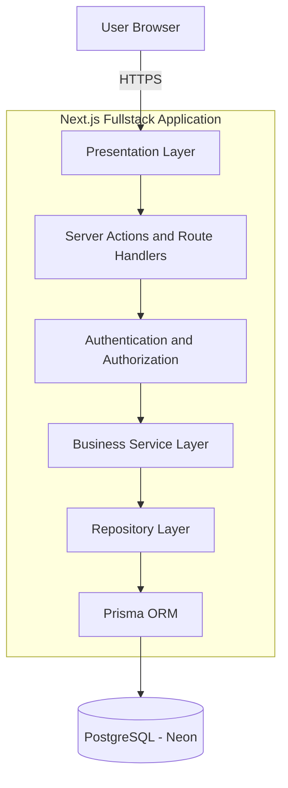
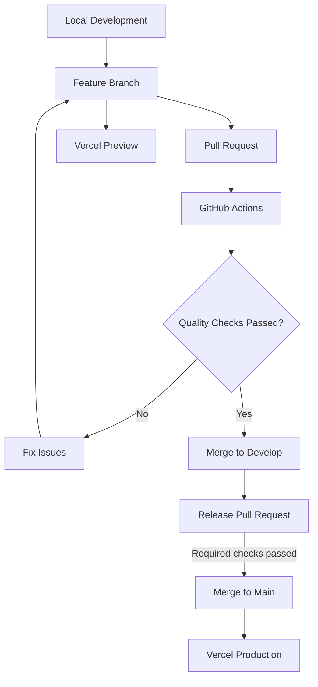

# CashierFlow


A modern full-stack Point of Sale (POS) and Inventory Management
System built with Next.js, TypeScript, PostgreSQL, and Prisma.

CashierFlow is designed to help small and medium-sized businesses
manage sales transactions, product inventory, and business
reporting through a centralized web application.

---

## Project Status

CashierFlow is currently under active development as part of
the **30 Days Fullstack & DevOps Challenge**.

| Information | Description |
|---|---|
| Project | CashierFlow |
| Current Phase | Project Planning |
| Current Version | 0.1.0-dev (planned) |
| Target Version | 1.0.0 |
| Start Date | November 20, 2026 |
| Target Release | December 3, 2026 |
| Development Duration | 14 Days |
| Architecture | Modular Monolith |
| Deployment | Vercel |

## Project Objectives

- Build a production-oriented full-stack web application.
- Implement secure authentication and role-based access control.
- Design a structured relational database.
- Implement reliable and atomic sales transactions.
- Maintain consistent inventory records.
- Develop automated unit, integration, and end-to-end tests.
- Implement Continuous Integration and Continuous Deployment.
- Maintain professional software engineering documentation.

## Planned Features

### Authentication and Authorization

- Email and password authentication.
- Secure session management.
- Role-Based Access Control (RBAC).
- Protected application routes.
- User account management.

### Dashboard

- Sales overview.
- Total revenue.
- Estimated gross profit.
- Total transactions.
- Inventory overview.
- Sales trend visualization.
- Best-selling products.

### Master Data

- Product management.
- Category management.
- Unit management.
- Supplier management.
- Customer management (optional).

### Inventory Management

- Stock overview.
- Stock in.
- Stock out.
- Stock adjustment.
- Stock movement history.
- Low-stock indicators.

### Point of Sale

- Product search.
- Barcode input.
- Shopping cart management.
- Quantity adjustment.
- Transaction discounts (optional).
- Cash payments.
- Automatic change calculation.
- Atomic database transactions.
- Checkout idempotency.
- Receipt generation.

### Transaction Management

- Transaction history.
- Transaction details.
- Invoice search.
- Date-based filtering.
- Receipt printing.
- Historical price and cost snapshots.

### Reports

- Sales reports.
- Estimated gross profit reports.
- Inventory reports.
- Date range filtering.
- Excel export (optional).

### Administration

- User management.
- Predefined role assignment.
- Activity logs (optional).
- Account activation and deactivation.
- Store settings (optional).

## Technology Stack

### Frontend

| Technology | Purpose |
|---|---|
| Next.js | Full-stack application framework |
| React | User interface |
| TypeScript | Type safety |
| Tailwind CSS | Styling |
| shadcn/ui | Reusable UI components |
| Zustand | Shopping cart state management |
| React Hook Form | Form management |
| Zod | Data validation |
| Recharts | Data visualization |

### Backend

| Technology | Purpose |
|---|---|
| Next.js Server Actions | Server-side application operations |
| Next.js Route Handlers | HTTP endpoints |
| Auth.js | Authentication |
| Prisma ORM | Database access |
| PostgreSQL | Relational database |

### Testing and Quality

| Technology | Purpose |
|---|---|
| ESLint | Static code analysis |
| Prettier | Code formatting |
| Vitest | Unit and integration testing |
| Playwright | End-to-end testing |
| TypeScript | Static type checking |

### Infrastructure and DevOps

| Technology | Purpose |
|---|---|
| Git | Version control |
| GitHub | Source code repository |
| GitHub Actions | Continuous Integration |
| Vercel | Continuous Deployment |
| Neon | Managed PostgreSQL database |
| Docker | Containerization and local development |

## System Architecture



CashierFlow follows a modular monolith architecture with clear
separation between presentation, business logic, authorization,
and database access.

## User Roles

| Role | Responsibilities |
|---|---|
| Owner | Business monitoring, financial reports, user administration |
| Admin | Master data, inventory, and operational reports |
| Cashier | Sales transactions, checkout, and personal transaction history |

## Project Structure

The following structure represents the planned application
architecture and will be introduced progressively.

```text
cashierflow/
├── .github/
│   └── workflows/
├── docs/
├── prisma/
│   ├── schema.prisma
│   └── migrations/
├── public/
├── src/
│   ├── app/
│   ├── components/
│   ├── features/
│   ├── server/
│   │   ├── actions/
│   │   ├── services/
│   │   ├── repositories/
│   │   └── authorization/
│   ├── schemas/
│   ├── hooks/
│   ├── stores/
│   ├── types/
│   └── lib/
├── tests/
│   ├── unit/
│   ├── integration/
│   └── e2e/
├── .env.example
├── .gitignore
├── Dockerfile
├── docker-compose.yml
├── package.json
└── README.md
```

## Project Documentation

All project documentation is available in the `docs` directory.

| Document | Description |
|---|---|
| [BRD](docs/BRD.md) | Business Requirements Document |
| [PRD](docs/PRD.md) | Product Requirements Document |
| [Functional Requirements](docs/functional-requirements.md) | Application functionality |
| [Non-Functional Requirements](docs/non-functional-requirements.md) | Quality and technical requirements |
| [Business Rules](docs/business-rules.md) | Business logic and transaction constraints |
| [User Stories](docs/user-stories.md) | User stories and acceptance criteria |
| [MVP Scope](docs/mvp-scope.md) | Feature prioritization and development roadmap |
| [Architecture](docs/architecture.md) | System architecture and CI/CD strategy |
| [ERD](docs/erd.md) | Entity Relationship Diagram |
| [Data Dictionary](docs/data-dictionary.md) | Database columns, types, and constraints |
| [CRUD Matrix](docs/crud-matrix.md) | Application data operation matrix |
| [RBAC Matrix](docs/rbac-matrix.md) | Role-based access control specification |
| [Database Design](docs/database-design.md) | Physical database design and integrity strategy |


Database design, API specifications, and deployment guides
will be added during subsequent development phases.

## Development Roadmap

| Day | Development Focus | Status |
|---|---|---|
| 01 | Project Planning and Requirements | Completed |
| 02 | Database Design and ERD | Completed |
| 03 | Next.js Project Initialization | Pending |
| 04 | Database Setup and CI/CD | Pending |
| 05 | Authentication and RBAC | Pending |
| 06 | Dashboard Layout and Components | Pending |
| 07 | Product, Category, and Unit Management | Pending |
| 08 | Supplier and Customer Management | Pending |
| 09 | Inventory Management | Pending |
| 10 | POS Interface and Shopping Cart | Pending |
| 11 | Atomic Checkout and Payment | Pending |
| 12 | Transaction History and Receipts | Pending |
| 13 | Dashboard Analytics and Reports | Pending |
| 14 | Testing and Production Deployment | Pending |

## CI/CD Pipeline

The planned development workflow uses GitHub Actions for
automated quality checks and Vercel for application deployment.



### Continuous Integration

- Dependency installation.
- ESLint validation.
- TypeScript type checking.
- Unit testing.
- Integration testing.
- Application build validation.
- End-to-end testing.

### Continuous Deployment

- Feature branch preview deployment.
- Development integration deployment.
- Production release from the main branch.
- Environment variable management.
- Controlled database migrations.
- Production smoke testing.

## Git Branching Strategy

| Branch | Purpose |
|---|---|
| main | Production-ready releases |
| develop | Development integration |
| feature/* | New feature development |
| fix/* | Bug fixes |
| hotfix/* | Urgent production fixes |

### Commit Convention

This project follows Conventional Commits.

```text
feat: implement product management
fix: resolve inventory validation
docs: update project documentation
test: add checkout integration tests
refactor: improve service architecture
ci: configure github actions
chore: update project configuration
```

## Security and Data Integrity

CashierFlow prioritizes:

- Secure password hashing.
- Server-side authentication and authorization.
- Input validation.
- Database constraints.
- Atomic database transactions.
- Concurrent inventory update handling.
- Checkout idempotency.
- Environment variable protection.
- Historical transaction integrity.
- Prevention of negative inventory.

## Getting Started

The application is currently in the project planning phase.

Installation instructions, environment configuration,
database migrations, and local development commands
will be added after project initialization.

## Live Demo

| Environment | Status |
|---|---|
| Development | Not configured |
| Preview | Coming soon |
| Production | Coming soon |
| CI/CD Pipeline | Planned |

## Screenshots

Application screenshots will be added after the
user interface implementation is completed.

## Future Enhancements

- QRIS payment gateway integration.
- Multi-branch store management.
- Refund and return management.
- Cashier shift management.
- Customer loyalty programs.
- Advanced inventory valuation.
- Offline POS functionality.
- Redis caching.
- Advanced business analytics.

## Author

**ZyxxBoy**

- GitHub: [@ZyxxBoy](https://github.com/ZyxxBoy)

## License

A license has not yet been selected.

---

Built as part of the **30 Days Fullstack & DevOps Challenge**.

CashierFlow is developed for educational and portfolio purposes.
