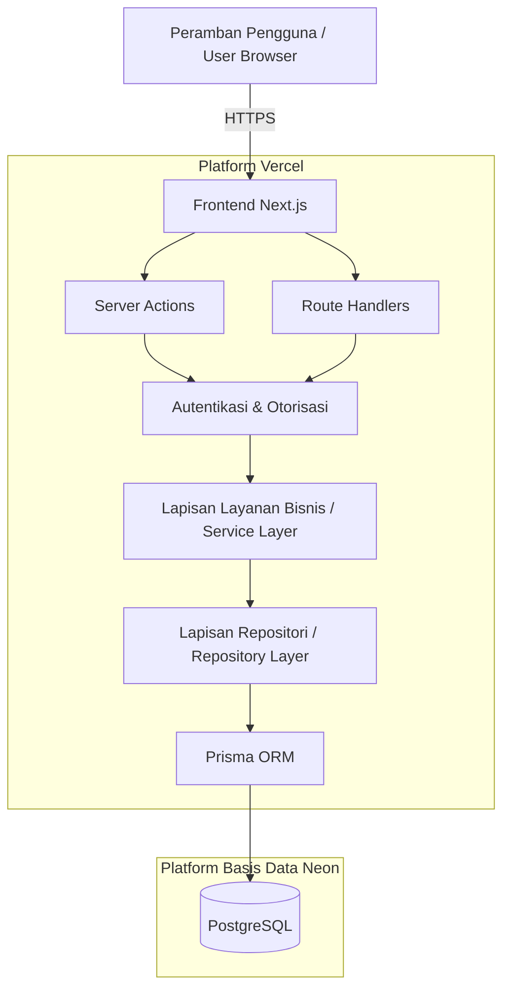
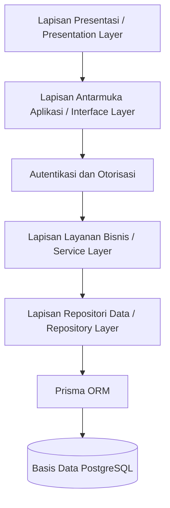
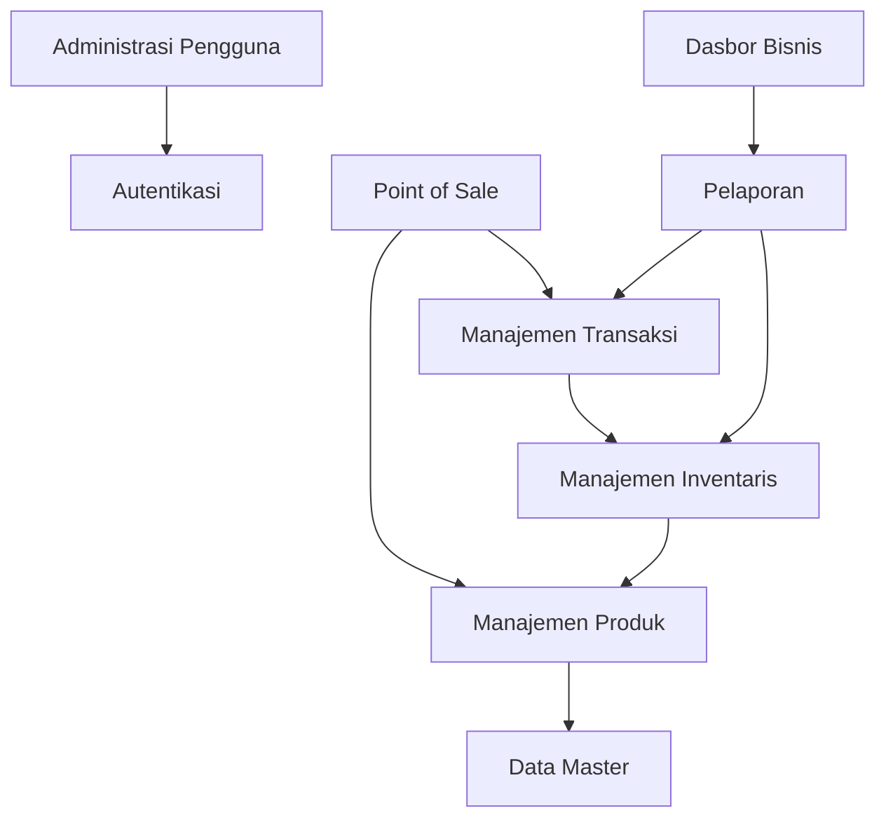
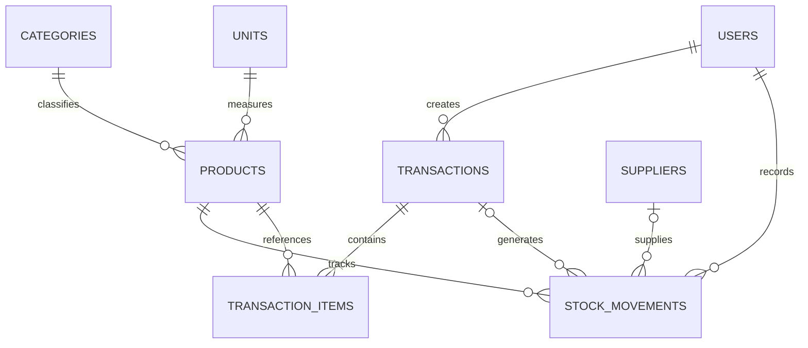
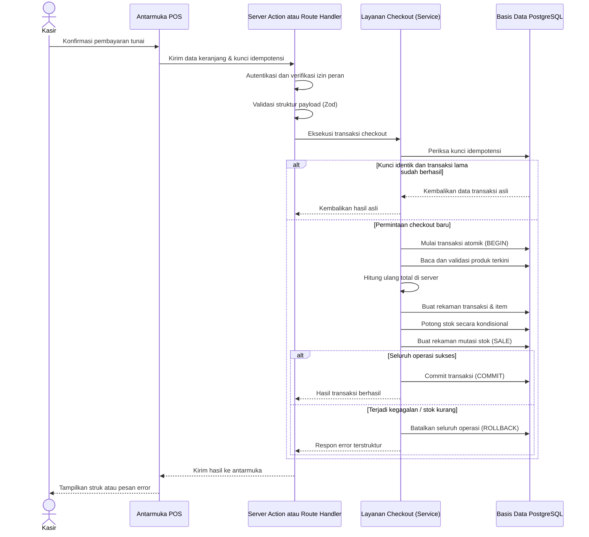
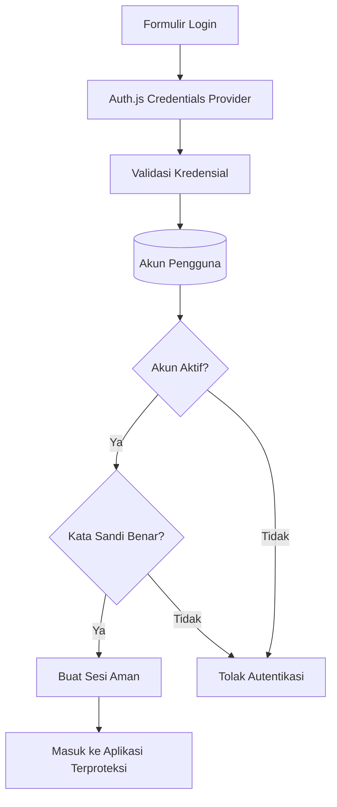
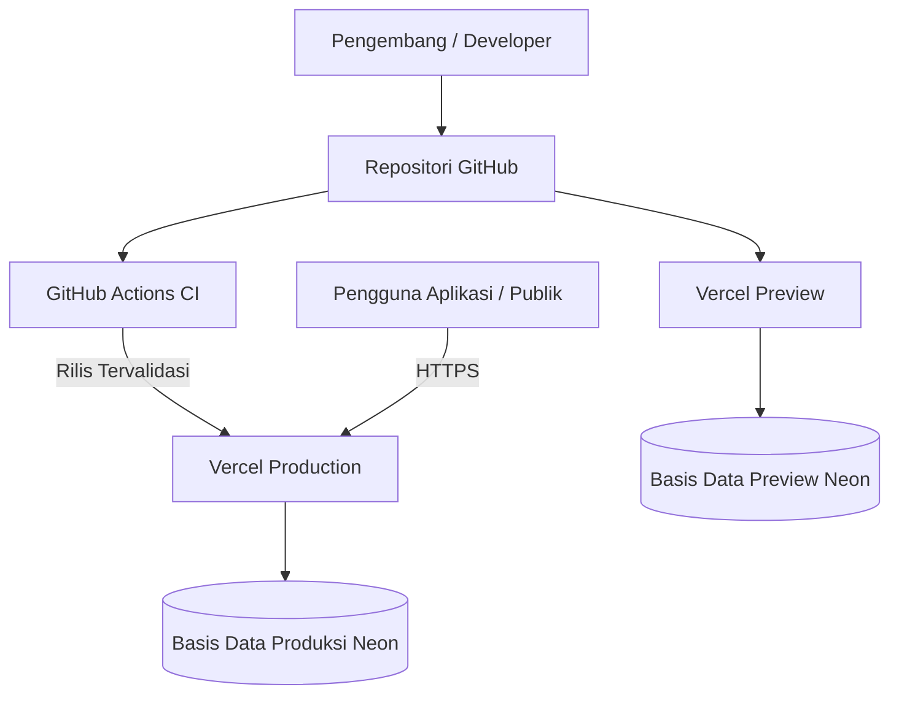
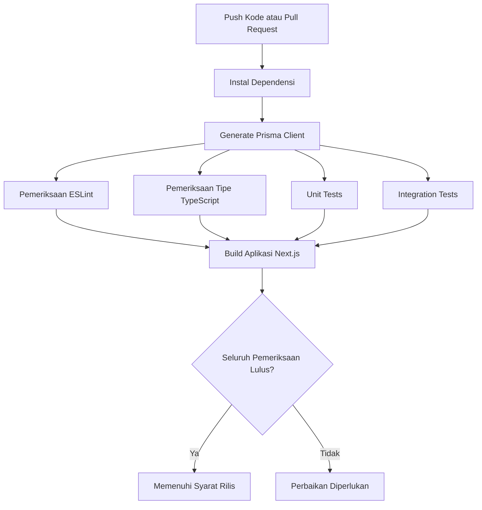
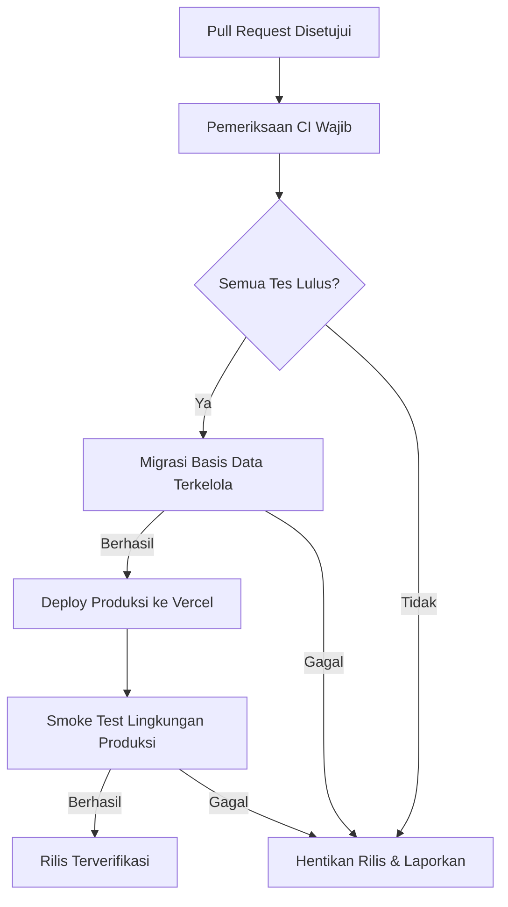
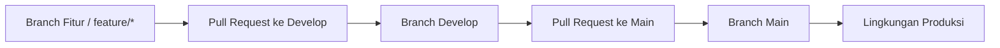

# Arsitektur Sistem CashierFlow

## 1. Informasi Dokumen

| Atribut | Deskripsi |
|---|---|
| Proyek | CashierFlow |
| Versi Dokumen | 1.0 |
| Versi Produk | 1.0.0 MVP |
| Penulis | ZyxxBoy |
| Arsitektur | Modular Monolith |
| Status | Initial Baseline |

## 2. Gambaran Umum Arsitektur

CashierFlow menggunakan pola arsitektur **Modular Monolith** yang dibangun dengan Next.js, TypeScript, Prisma ORM, dan basis data relasional PostgreSQL.

Frontend dan backend dikelola di dalam satu repositori tunggal (monorepo/single codebase), namun logika bisnis, akses basis data, validasi skema, dan lapisan presentasi antarmuka dipisahkan secara tegas ke dalam modul-modul logis.

Arsitektur ini meminimalkan kompleksitas deployment dan pemeliharaan infrastruktur sekaligus mempertahankan pemisahan tanggung jawab kode yang rapi.

## 3. Sasaran Arsitektur

- Mempertahankan model deployment yang sederhana dan hemat sumber daya.
- Memisahkan logika bisnis secara tegas dari lapisan antarmuka (UI).
- Meningkatkan kemudahan pemeliharaan (maintainability) dan pengujian otomatis (testability).
- Menerapkan batasan keamanan yang konsisten di sisi server.
- Menjamin integritas dan konsistensi transaksi data secara mutlak.
- Mempermudah pengembangan dan penambahan modul di masa mendatang.
- Mendukung integrasi alur otomatisasi pengujian dan deployment (CI/CD).
- Menghindari kerumitan infrastruktur yang berlebihan dan belum diperlukan.

## 4. Arsitektur Sistem Tingkat Tinggi (High-Level)



Server Components juga dapat memanggil lapisan layanan bisnis di sisi server secara langsung tanpa perlu melakukan permintaan HTTP internal yang tidak diperlukan.

Autentikasi dan otorisasi merupakan persyaratan logis yang wajib dieksekusi pada setiap operasi yang dilindungi.

## 5. Stack Teknologi

### 5.1 Frontend

| Teknologi | Tanggung Jawab |
|---|---|
| Next.js App Router | Routing aplikasi dan rendering halaman |
| React | Pustaka antarmuka pengguna (UI) |
| TypeScript | Pengetikan statis yang ketat (strict typing) |
| Tailwind CSS | Kerangka kerja styling antarmuka |
| shadcn/ui | Pustaka komponen UI yang dapat disesuaikan |
| React Hook Form | Manajemen status formulir |
| Zod | Validasi skema input |
| Zustand | Manajemen state keranjang belanja POS pada klien |
| Recharts | Visualisasi grafik dasbor (opsional) |

### 5.2 Backend

| Teknologi | Tanggung Jawab |
|---|---|
| Next.js Server Actions | Mutasi data aplikasi internal |
| Next.js Route Handlers | Endpoint HTTP publik/integrasi |
| Auth.js | Autentikasi dan manajemen sesi pengguna |
| Zod | Validasi data permintaan di sisi server |
| Prisma | Object-Relational Mapping (ORM) basis data |
| PostgreSQL | Penyimpanan basis data relasional persisten |

### 5.3 Pengujian (Testing)

| Teknologi | Tanggung Jawab |
|---|---|
| ESLint | Analisis kode statis (linting) |
| Prettier | Format kerapian kode otomatis |
| TypeScript | Pemeriksaan tipe data statis |
| Vitest | Pengujian unit dan pengujian integrasi |
| Playwright | Pengujian end-to-end (E2E) alur pengguna |

### 5.4 Infrastruktur

| Teknologi | Tanggung Jawab |
|---|---|
| GitHub | Manajemen repositori kode sumber |
| GitHub Actions | Otomatisasi Continuous Integration (CI) |
| Vercel | Hosting dan deployment aplikasi web |
| Neon | Basis data PostgreSQL terkelola (serverless) |
| Docker | Lingkungan pengembangan lokal & kontainerisasi |
| Vercel Logs | Observabilitas runtime dan error log bawaan |

## 6. Arsitektur Lapisan Aplikasi



### 6.1 Lapisan Presentasi (Presentation Layer)

Tanggung jawab:

- Halaman aplikasi (pages).
- Tata letak (layouts) dan navigasi.
- Komponen antarmuka pengguna (UI components).
- Formulir interaktif.
- Interaksi sisi klien.
- Tampilan status pemuatan (loading) dan pesan error.
- Interaksi pengguna pada keranjang belanja POS.

Lapisan presentasi pada Client Components dilarang keras mengakses basis data secara langsung.

### 6.2 Lapisan Antarmuka Aplikasi (Interface Layer)

Tanggung jawab:

- Server Actions.
- Route Handlers.
- Penanganan request dan response.
- Validasi awal bentuk permintaan (payload schema).
- Pemicu pemeriksaan autentikasi dan otorisasi.
- Mendelegasikan eksekusi ke lapisan layanan bisnis.

Lapisan antarmuka tidak boleh memuat logika transaksi atau aturan bisnis yang kompleks.

### 6.3 Lapisan Layanan Bisnis (Business Service Layer)

Tanggung jawab:

- Penegakan aturan bisnis inti.
- Validasi status dan ketersediaan produk.
- Perhitungan stok inventaris.
- Perhitungan total transaksi, diskon, dan kembalian.
- Orkestrasi alur checkout.
- Pembatasan logika bisnis berdasarkan izin otorisasi.
- Penentuan batasan transaksi atomik (transaction boundaries).

Lapisan ini merupakan pusat utama dari seluruh aturan dan alur kerja aplikasi.

### 6.4 Lapisan Repositori (Repository Layer)

Tanggung jawab:

- Eksekusi query basis data.
- Persistensi data.
- Penerapan filter dan paginasi data.
- Pembaruan kondisional stok inventaris.
- Operasi basis data yang sadar transaksi (transaction-aware).

Repositori wajib mendukung penerimaan instance klien Prisma dalam konteks transaksi (`tx`) saat terlibat dalam operasi atomik.

### 6.5 Lapisan Basis Data (Database Layer)

Tanggung jawab:

- Penyimpanan data persisten yang andal.
- Penegakan konstrain primary key dan foreign key.
- Penegakan unique constraints dan check constraints.
- Pengindeksan kolom untuk kecepatan query.
- Penjaminan isolasi transaksi atomik (ACID).

## 7. Usulan Struktur Direktori Proyek

Struktur berikut akan diterapkan secara bertahap selama masa pengembangan:

```text
cashierflow/
├── .github/
│   └── workflows/
│       └── ci.yml
├── docs/
│   ├── BRD.md
│   ├── PRD.md
│   ├── functional-requirements.md
│   ├── non-functional-requirements.md
│   ├── business-rules.md
│   ├── user-stories.md
│   ├── mvp-scope.md
│   ├── architecture.md
│   ├── erd.md
│   ├── data-dictionary.md
│   ├── crud-matrix.md
│   └── rbac-matrix.md
├── prisma/
│   ├── schema.prisma
│   ├── migrations/
│   └── seed.ts
├── public/
├── src/
│   ├── app/
│   │   ├── (auth)/
│   │   │   └── login/
│   │   ├── (dashboard)/
│   │   │   ├── dashboard/
│   │   │   ├── pos/
│   │   │   ├── master-data/
│   │   │   ├── inventory/
│   │   │   ├── transactions/
│   │   │   ├── reports/
│   │   │   ├── administration/
│   │   │   ├── settings/
│   │   │   └── layout.tsx
│   │   ├── api/
│   │   │   ├── auth/
│   │   │   ├── v1/
│   │   │   └── health/
│   │   ├── globals.css
│   │   ├── layout.tsx
│   │   └── page.tsx
│   ├── components/
│   │   ├── ui/
│   │   ├── layouts/
│   │   └── shared/
│   ├── features/
│   │   ├── auth/
│   │   ├── dashboard/
│   │   ├── products/
│   │   ├── categories/
│   │   ├── units/
│   │   ├── suppliers/
│   │   ├── customers/
│   │   ├── inventory/
│   │   ├── pos/
│   │   ├── transactions/
│   │   ├── reports/
│   │   └── users/
│   ├── server/
│   │   ├── actions/
│   │   ├── services/
│   │   ├── repositories/
│   │   └── authorization/
│   ├── schemas/
│   ├── hooks/
│   ├── stores/
│   ├── types/
│   ├── constants/
│   ├── config/
│   ├── lib/
│   │   ├── prisma.ts
│   │   ├── errors.ts
│   │   ├── logger.ts
│   │   └── utils.ts
│   └── auth.ts
├── tests/
│   ├── unit/
│   ├── integration/
│   └── e2e/
├── .env.example
├── .gitignore
├── Dockerfile
├── docker-compose.yml
├── eslint.config.mjs
├── next.config.ts
├── package.json
├── package-lock.json
├── playwright.config.ts
├── tsconfig.json
├── vitest.config.ts
└── README.md
```

Modul opsional tidak boleh dibuat secara prematur sebelum fitur intinya selesai.

## 8. Arsitektur Modul



Seluruh modul yang dilindungi bergantung pada mekanisme autentikasi dan otorisasi bersama.

Antarmodul harus berkomunikasi melalui antarmuka service layer yang terdefinisi dengan baik, bukan dengan mengubah rekaman basis data modul lain secara serampangan.

## 9. Arsitektur Basis Data Awal

PostgreSQL digunakan sebagai basis data relasional utama.

### 9.1 Entitas Inti yang Diusulkan

| Entitas | Tanggung Jawab |
|---|---|
| users | Akun pengguna aplikasi beserta peran dan kredensialnya |
| categories | Pengelompokan klasifikasi kategori produk |
| units | Satuan ukuran unit produk |
| products | Informasi produk, harga, dan jumlah stok terkini |
| suppliers | Informasi profil pemasok barang |
| stock_movements | Riwayat pergerakan dan mutasi stok inventaris |
| transactions | Transaksi penjualan yang telah selesai dan ringkasan pembayaran |
| transaction_items | Rincian barang yang dibeli beserta snapshot nilai historisnya |

### 9.2 Entitas Opsional

| Entitas | Tanggung Jawab |
|---|---|
| customers | Informasi data pelanggan |
| activity_logs | Catatan riwayat aktivitas penting pengguna |
| store_settings | Konfigurasi informasi toko dan format struk |

Sistem MVP menggunakan peran pengguna bawaan. Enum pada basis data atau kolom teks dengan konstrain sudah memadai untuk tahap awal.

Tabel terpisah untuk peran kustom dan manajemen izin granular belum diperlukan pada rilis pertama.

Tabel pendukung untuk Auth.js dapat ditambahkan jika strategi manajemen sesi membutuhkannya.

### 9.3 Relasi Entitas Awal (Konseptual)



Diagram di atas merupakan gambaran konseptual awal, bukan ERD fisik final. Desain basis data fisik lengkap beserta tipe kolom, constraint, indeks, dan aturan cascade akan diselesaikan pada Hari ke-02.

## 10. Strategi Integritas Data

Sistem wajib menegakkan aturan integritas data berikut:

- Primary key untuk setiap entitas persisten.
- Foreign key untuk menjaga integritas relasi antartabel.
- Alamat email yang unik dan dinormalisasi.
- SKU produk yang unik dan dinormalisasi.
- Barcode yang unik jika diisi (bukan string kosong).
- Nomor faktur/invoice yang unik secara global.
- Konstrain nilai stok barang tidak boleh negatif (`stock >= 0`).
- Kuantitas penjualan wajib berupa bilangan positif (`quantity > 0`).
- Harga jual wajib lebih besar dari nol (`selling_price > 0`).
- Harga beli/modal tidak boleh negatif (`purchase_cost >= 0`).
- Kunci idempotensi unik per akun pengguna.

Konstrain basis data yang tidak dapat direpresentasikan secara langsung oleh skema bawaan ORM harus ditambahkan melalui skrip migrasi SQL tertinjau.

## 11. Arsitektur Transaksi Checkout



### 11.1 Atomisitas (Atomicity)

Proses checkout menggunakan transaksi interaktif Prisma (`prisma.$transaction`).

Batasan transaksi mencakup:

- Pembuatan rekaman transaksi induk.
- Pembuatan rekaman rincian item transaksi.
- Pencatatan informasi pembayaran uang tunai.
- Pemotongan kuantitas stok barang di tabel produk.
- Pembuatan rekaman mutasi stok untuk setiap item.
- Penyimpanan rekaman status kunci idempotensi.

Jika terjadi satu saja kegagalan dalam proses di atas, seluruh transaksi wajib di-rollback secara penuh.

### 11.2 Kontrol Konkurensi (Concurrency Control)

Pembaruan stok inventaris tidak boleh menggunakan pendekatan baca-lalu-tulis (*read-then-write*) yang tidak terlindungi.

Implementasi wajib:

1. Memvalidasi ketersediaan dan status produk terkini.
2. Menggunakan pembaruan kondisional di basis data yang memverifikasi bahwa stok mencukupi saat perintah pembaruan dijalankan (`WHERE id = ? AND stock >= ?`).
3. Memeriksa jumlah baris yang terpengaruh (affected rows count).
4. Membatalkan transaksi jika stok ternyata tidak lagi mencukupi.
5. Memproses identitas produk dalam urutan deterministik (misal: diurutkan berdasarkan Product ID) untuk mencegah kebuntuan (*deadlock*).
6. Menangani konflik transaksi dan deadlock dengan aman.
7. Mengulang (retry) hanya untuk kegagalan transien yang aman dengan batas perulangan terbatas.

Perubahan harga dan status produk yang terjadi bersamaan juga harus ditangani melalui isolasi transaksi, penguncian baris, atau pemeriksaan versi data yang memadai.

### 11.3 Idempotensi (Idempotency)

Setiap transaksi checkout yang diniatkan di sisi klien wajib menghasilkan kunci acak unik (UUID).

Basis data menegakkan keunikan kombinasi antara ID pengguna pemohon dan kunci idempotensi tersebut.

Permintaan identik yang berhasil sebelumnya akan langsung mengembalikan hasil transaksi asli tanpa membuat transaksi baru.

Permintaan dengan data yang berbeda menggunakan kunci yang sama akan ditolak dengan error konflik status.

Tabrakan kunci bersamaan harus direkonsiliasi dengan data yang telah di-commit sebelum merespons ke klien.

## 12. Arsitektur Autentikasi



Persyaratan autentikasi:

- Login berbasis email dan kata sandi.
- Algoritma hashing kata sandi standar industri yang aman.
- Manajemen sesi terproteksi dengan cookie aman.
- Pendaftaran mandiri publik (self-registration) tidak diizinkan.
- Akun Owner pertama kali dibuat melalui skrip seed yang terkontrol.
- Validasi status akun dan hak akses pengguna dilakukan di sisi server pada setiap operasi.

Strategi sesi yang dipilih harus mampu mendeteksi dan menerapkan penonaktifan akun serta perubahan peran secara efektif.

## 13. Arsitektur Otorisasi (RBAC)

Aplikasi menerapkan Kontrol Akses Berbasis Peran (Role-Based Access Control - RBAC).

### Peran yang Didukung

- OWNER (Pemilik Usaha)
- ADMIN (Administrator)
- CASHIER (Kasir)

Setiap operasi terproteksi mengikuti urutan logis berikut:

1. Validasi sesi autentikasi pengguna.
2. Identifikasi pengguna aktif yang bersangkutan.
3. Tentukan peran efektif yang dimiliki pengguna.
4. Periksa apakah peran tersebut memiliki izin untuk operasi ini.
5. Periksa kepemilikan sumber daya data jika relevan (misal: kasir hanya boleh melihat transaksinya sendiri).
6. Eksekusi logika bisnis.

Visibilitas tombol atau menu di UI bukanlah batas keamanan sistem.

Kolom-kolom basis data yang bersifat rahasia (seperti harga modal dan estimasi laba kotor) wajib disaring dan ditiadakan dari payload yang dikirimkan ke pengguna yang tidak berhak.

## 14. Strategi API dan Server Action

Aplikasi memanfaatkan kombinasi Server Actions dan Route Handlers.

### Server Actions

Digunakan terutama untuk:

- Pengiriman formulir data.
- Mutasi data master (tambah, edit, nonaktifkan).
- Operasi administrasi pengguna.
- Operasi inventaris stok masuk, keluar, dan penyesuaian.

### Route Handlers

Digunakan untuk kebutuhan antarmuka HTTP eksplisit:

- Permintaan transaksi checkout jika mengekspos endpoint HTTP khusus.
- Pencarian produk kasir (POS product search).
- Unduhan berkas ekspor laporan.
- Endpoint health check sistem.
- Kebutuhan integrasi eksternal di masa depan.

Tidak ada keharusan mengekspos setiap fitur internal ke dalam bentuk REST endpoint publik.

Baik Server Actions maupun Route Handlers wajib memanggil lapisan layanan bisnis (Service Layer) yang sama.

### Endpoint HTTP yang Diusulkan

| Metode | Endpoint | Tanggung Jawab |
|---|---|---|
| GET | /api/health | Memeriksa keaktifan sistem aplikasi |
| GET | /api/v1/products/search | Mencari produk yang diizinkan untuk kasir |
| POST | /api/v1/transactions/checkout | Mengirimkan permintaan checkout penjualan |
| GET | /api/v1/transactions/:id | Mengambil data detail transaksi yang diizinkan |
| GET | /api/v1/reports/sales/export | Mengunduh berkas laporan penjualan |

Endpoint ekspor bersifat opsional. Kontrak payload endpoint akan difinalisasi pada saat implementasi.

### Contoh Respons Berhasil (JSON)

```json
{
  "success": true,
  "data": {
    "invoiceNumber": "CF-20261120-8F42A1",
    "total": 45000,
    "cashReceived": 50000,
    "change": 5000
  }
}
```

### Contoh Respons Error (JSON)

```json
{
  "success": false,
  "error": {
    "code": "INSUFFICIENT_STOCK",
    "message": "Jumlah kuantitas yang diminta melebihi stok yang tersedia."
  }
}
```

## 15. Strategi Manajemen State

| Jenis State | Pendekatan |
|---|---|
| Data Server-rendered | React Server Components (RSC) |
| State Formulir | React Hook Form |
| Validasi Skema | Zod |
| Keranjang Belanja POS | Zustand (Client-side state) |
| State UI Lokal | React useState / useReducer |
| Filter dan Paginasi | URL Search Parameters |
| State Sesi Autentikasi | Auth.js |

State keranjang belanja di sisi klien bersifat sementara dan bukan merupakan sumber data otoritatif untuk harga maupun sisa stok barang.

Data pengguna terautentikasi tidak boleh di-cache secara publik yang dapat menimbulkan kebocoran data antar-pengguna.

## 16. Arsitektur Deployment



### Definisi Lingkungan

| Lingkungan | Tujuan | Basis Data |
|---|---|---|
| Development | Pengembangan lokal harian | Basis data lokal atau development terisolasi |
| Preview | Validasi fungsional fitur PR | Basis data preview terisolasi |
| Production | Demo MVP publik | Basis data produksi demo |
| CI Test | Pengujian otomatis alur CI | Basis data pengujian ephemeral / terisolasi |

Kredensial basis data produksi dilarang keras digunakan untuk keperluan lingkungan preview atau pengujian otomatis.

## 17. Continuous Integration (CI)

GitHub Actions memvalidasi integritas setiap perubahan kode sebelum dapat digabungkan ke branch utama.



Operasi wajib pada alur CI:

1. Checkout kode sumber repositori.
2. Konfigurasi runtime Node.js.
3. Instalasi dependensi terkunci (`package-lock.json`).
4. Generate Prisma Client.
5. Menjalankan pemeriksaan ESLint.
6. Menjalankan pemeriksaan kompilasi TypeScript.
7. Menjalankan pengujian unit (unit tests).
8. Menjalankan pengujian integrasi (integration tests) dengan basis data PostgreSQL terisolasi.
9. Memverifikasi proses build aplikasi.
10. Melaporkan status hasil alur kerja ke GitHub.

Skenario E2E Playwright yang bersifat kritis wajib lulus sebelum versi rilis diluncurkan ke produksi.

## 18. Continuous Deployment (CD)

### Strategi Deployment Awal

Integrasi Git Vercel otomatis digunakan untuk:

- Deployment pratinjau (Preview) pada branch fitur.
- Integrasi pratinjau pada branch pengembangan.
- Deployment otomatis ke lingkungan produksi dari branch `main`.

Pengembang wajib memastikan seluruh pemeriksaan pada alur CI berhasil lulus sebelum melakukan merge ke branch `main`.

### Strategi Deployment Lanjutan

Alur lanjutan menggunakan kombinasi GitHub Actions dan Vercel CLI agar proses deployment ke produksi benar-benar terkunci dan hanya berjalan setelah rangkaian pengujian lulus.



## 19. Strategi Git Branching dan Conventional Commits

| Branch | Tujuan |
|---|---|
| main | Versi stabil siap produksi (production-ready) |
| develop | Integrasi fitur sebelum persiapan rilis |
| feature/* | Pengembangan fitur baru |
| fix/* | Perbaikan bug non-kritis |
| hotfix/* | Perbaikan darurat langsung untuk lingkungan produksi |

### Alur Siklus Pengembangan



### Konvensi Commit (Conventional Commits)

| Tipe | Penggunaan |
|---|---|
| feat | Menambah fitur atau fungsionalitas baru |
| fix | Memperbaiki bug atau kesalahan sistem |
| docs | Menambah atau mengubah dokumentasi |
| refactor | Restrukturisasi kode tanpa mengubah fungsionalitas |
| test | Menambah atau memperbarui pengujian otomatis |
| ci | Konfigurasi sistem CI/CD dan alur kerja otomatis |
| chore | Pemeliharaan dependensi atau tugas rutin |
| perf | Peningkatan performa kode atau query |
| build | Perubahan pada sistem build atau konfigurasi paket |

Contoh pesan commit:

    docs: tambahkan dokumen kebutuhan bisnis BRD
    feat: implementasikan manajemen data master produk
    feat: implementasikan transaksi checkout atomik
    test: tambahkan pengujian konkurensi checkout
    ci: konfigurasikan alur kerja github actions
    fix: cegah akses tidak sah ke riwayat transaksi kasir lain

## 20. Konfigurasi Lingkungan (Environment Variables)

### Variabel yang Diusulkan

| Variabel | Tujuan |
|---|---|
| DATABASE_URL | String koneksi basis data PostgreSQL untuk runtime aplikasi |
| AUTH_SECRET | Kunci enkripsi rahasia sesi Auth.js |
| APP_URL | URL dasar aplikasi web jika dibutuhkan |
| STORE_TIMEZONE | Zona waktu default toko (misal: `Asia/Jakarta`) |
| SEED_OWNER_EMAIL | Email untuk inisialisasi akun Owner pertama kali |
| SEED_OWNER_PASSWORD | Kata sandi untuk inisialisasi akun Owner pertama kali |

Kredensial asli wajib disimpan pada file lokal yang di-ignore (`.env.local`), GitHub Secrets, atau Vercel Environment Variables. Repositori Git hanya boleh menyimpan file contoh tanpa nilai rahasia (`.env.example`).

## 21. Strategi Migrasi Basis Data

- Seluruh perubahan skema basis data wajib dicatat di dalam Git.
- Pembuatan file migrasi dilakukan di lingkungan pengembangan lokal (`prisma migrate dev`).
- File SQL hasil migrasi wajib ditinjau sebelum di-commit.
- Uji eksekusi migrasi pada basis data terisolasi sebelum diterapkan ke produksi.
- Penerapan migrasi ke produksi dilakukan melalui perintah deployment terkontrol (`prisma migrate deploy`).
- Hindari perubahan skema yang bersifat destruktif; utamakan perubahan yang *backward-compatible*.
- Pastikan ketersediaan opsi pemulihan data (backup/recovery) sebelum menjalankan migrasi berisiko tinggi.

Migrasi basis data tidak boleh dijalankan secara otomatis pada setiap request serverless aplikasi.

Perlu dicatat bahwa rollback kode aplikasi tidak secara otomatis membatalkan perubahan skema pada basis data.

## 22. Arsitektur Pengujian (Testing)

### Pengujian Unit (Unit Testing)

Menguji logika bisnis murni yang terisolasi:

- Kalkulasi total transaksi belanja.
- Validasi aturan potongan diskon.
- Validasi kecukupan pembayaran uang tunai.
- Validasi aturan jumlah stok.
- Formula kalkulasi laba kotor.
- Pemeriksaan izin hak akses peran.

### Pengujian Integrasi (Integration Testing)

Menguji interaksi antarmodul dan akses basis data PostgreSQL terisolasi:

- Penyimpanan dan pembacaan produk.
- Mutasi stok barang masuk, keluar, dan penyesuaian.
- Eksekusi transaksi atomik checkout.
- Rollback transaksi saat terjadi kegagalan.
- Penegakan unique constraints dan foreign keys.
- Efektivitas penanganan idempotensi.
- Pembaruan stok secara konkuren.

### Pengujian End-to-End (E2E Testing)

Menguji alur lengkap perjalanan pengguna melalui antarmuka web:

- Alur login berhasil dan penolakan kredensial salah.
- Penolakan akses ke rute terproteksi.
- Pembuatan dan pembaruan data master produk.
- Pencatatan operasi stok barang.
- Alur lengkap transaksi penjualan kasir (POS).
- Penolakan checkout saat uang pembayaran kurang.
- Tampilan dan pencetakan struk transaksi.

## 23. Arsitektur Keamanan

Lapisan pertahanan keamanan sistem meliputi:

- Penegakan koneksi aman HTTPS.
- Hashing kata sandi yang kuat dan aman.
- Manajemen cookie sesi dengan proteksi HttpOnly, Secure, dan SameSite.
- Otorisasi RBAC ketat di sisi server.
- Pemeriksaan kepemilikan data (ownership checks).
- Validasi ketat seluruh payload input menggunakan Zod.
- Penggunaan parameterized query untuk mencegah SQL Injection.
- Perlindungan dari serangan CSRF.
- Pembatasan laju request (rate limiting) pada aksi autentikasi dan mutasi sensitif.
- Penanganan error yang aman tanpa mengekspos rincian database atau kredensial.
- Peninjauan keamanan dependensi berkala (`npm audit`).
- Isolasi total kredensial rahasia pada environment variables.
- Pembatasan akses demo publik hanya dengan data fiktif.

## 24. Strategi Penanganan Error

Sistem mengklasifikasikan error secara terstruktur:

- Error validasi input.
- Error kegagalan autentikasi.
- Error pelanggaran otorisasi / hak akses.
- Error data sumber daya tidak ditemukan (not found).
- Error pelanggaran aturan bisnis (business rule violations).
- Error konflik transaksi atau idempotensi.
- Error kegagalan infrastruktur basis data atau server.

Error bisnis yang diperkirakan mengembalikan respons aman dan terstruktur dengan kode error yang jelas.

Error yang tidak terduga dicatat secara internal pada log server tanpa mengekspos detail teknis atau kredensial kepada klien.

## 25. Logging dan Monitoring

Sistem MVP memanfaatkan:

- Log error server-side terstruktur.
- Log deployment dan log runtime bawaan platform Vercel.
- Log eksekusi alur kerja pada GitHub Actions.
- Endpoint health check `/api/health` untuk memverifikasi keaktifan aplikasi.

Endpoint health check melaporkan status liveness aplikasi tanpa membocorkan informasi infrastruktur internal.

Platform observabilitas pihak ketiga yang kompleks berada di luar cakupan MVP rilis awal.

## 26. Strategi Docker

Docker digunakan untuk standarisasi lingkungan pengembangan lokal, reproduksi pengujian otomatis, dan portabilitas deployment di masa depan.

File Docker Compose menyediakan:

- Container aplikasi web Next.js.
- Container basis data PostgreSQL lokal.

Deployment ke platform Vercel tidak bergantung pada file Dockerfile aplikasi.

Dukungan kontainer untuk lingkungan produksi dapat diadopsi di masa depan tanpa perlu mengubah arsitektur bisnis inti aplikasi.

## 27. Rekaman Keputusan Arsitektur (Architectural Decision Records - ADR)

| ID | Keputusan | Alasan dan Rasional |
|---|---|---|
| ADR-001 | Modular Monolith | Memudahkan pengembangan dan deployment mandiri untuk skala MVP |
| ADR-002 | Next.js Fullstack | Menggabungkan frontend dan backend dalam satu framework TypeScript terpadu |
| ADR-003 | PostgreSQL | Menjamin integritas relasional, kepatuhan ACID, dan keandalan transaksi |
| ADR-004 | Prisma ORM | Menyediakan akses basis data type-safe dan alur migrasi skema yang terkelola |
| ADR-005 | Auth.js | Pustaka autentikasi yang matang, aman, dan terintegrasi baik dengan Next.js |
| ADR-006 | Zustand | Manajemen state keranjang belanja kasir yang ringan dan mudah digunakan |
| ADR-007 | Neon Database | PostgreSQL serverless terkelola dengan tier gratis untuk deployment awal |
| ADR-008 | Vercel | Platform hosting web optimal untuk Next.js dengan fitur Preview deployments |
| ADR-009 | GitHub Actions | Otomatisasi alur CI terintegrasi langsung dengan repositori kode sumber |
| ADR-010 | Nominal Rupiah Bulat (Integer IDR) | Menghindari potensi bug pembulatan desimal (floating-point precision error) |
| ADR-011 | Checkout Atomik | Mencegah transaksi tersimpan sebagian dan inkonsistensi stok barang |
| ADR-012 | Satu Toko Tunggal (Single Store) | Menjaga agar ruang lingkup MVP tetap realistis diselesaikan dalam 14 hari |
| ADR-013 | Peran Pengguna Bawaan | Menyederhanakan kontrol otorisasi tanpa skema hak akses dinamis yang rumit |
| ADR-014 | Snapshot Harga Historis | Mempertahankan keakuratan estimasi laba kotor di masa lalu |
| ADR-015 | Tanpa Microservices | Menghindari kerumitan sistem terdistribusi prematur yang tidak dibutuhkan |

## 28. Trade-off Arsitektur

### Pola Modular Monolith

Kelebihan:

- Kompleksitas infrastruktur jauh lebih rendah.
- Pengembangan dan pengujian di lingkungan lokal lebih mudah dan cepat.
- Koordinasi transaksi basis data jauh lebih sederhana dan terjamin.
- Waktu pengiriman produk (time-to-market) jauh lebih cepat.

Keterbatasan:

- Seluruh modul berbagi lingkungan runtime deployment yang sama.
- Penskalaan modul secara independen tidak dapat dilakukan.
- Memerlukan disiplin pengembang agar batasan antarmodul tidak dilanggar.

### Deployment Serverless (Vercel & Neon)

Kelebihan:

- Setup awal deployment sangat cepat dan mudah.
- Infrastruktur terkelola tanpa perlu mengelola server virtual secara manual.
- Mendukung fitur preview environment otomatis untuk setiap pull request.
- Bebas biaya awal untuk batas penggunaan tertentu.

Keterbatasan:

- Potensi terjadi waktu tunda awal (cold start).
- Terdapat batas durasi eksekusi request dan batas memori komputasi.
- Memerlukan pengelolaan koneksi basis data yang cermat (connection pooling).
- Kurang cocok untuk proses background berdurasi panjang secara kontinu.

### Akses Data Berbasis ORM (Prisma)

Kelebihan:

- Akses data type-safe penuh dengan TypeScript.
- Menghindari penulisan query dasar yang berulang.
- Alur kerja migrasi skema terintegrasi dengan baik.

Keterbatasan:

- Query SQL yang sangat kompleks terkadang membutuhkan raw query manual.
- Query yang digenerate otomatis perlu ditinjau agar tidak menimbulkan masalah performa.
- Sebagian constraint basis data tingkat lanjut memerlukan migrasi SQL manual.

## 29. Pertimbangan Arsitektur Masa Depan

Aplikasi dapat dikembangkan lebih lanjut untuk mendukung:

- Isolasi data multi-toko dan multi-cabang.
- Webhook notifikasi pembayaran digital otomatis (QRIS / payment gateway).
- Rate limiting terdistribusi menggunakan Upstash Redis.
- Pemrosesan antrean tugas latar belakang (background job processing).
- Penyimpanan objek cloud (cloud object storage) untuk gambar produk.
- Notifikasi real-time menggunakan WebSockets atau Server-Sent Events.
- Deployment kontainer penuh ke layanan seperti AWS ECS atau Google Cloud Run.
- Platform monitoring performa aplikasi dan log terpusat (APM).

Seluruh komponen ini hanya akan ditambahkan apabila telah benar-benar dibutuhkan oleh perkembangan skala bisnis.

## 30. Dokumen Terkait

- [Dokumen Persyaratan Bisnis (BRD)](BRD.md)
- [Dokumen Persyaratan Produk (PRD)](PRD.md)
- [Persyaratan Fungsional (FRS)](functional-requirements.md)
- [Persyaratan Non-Fungsional (NFRS)](non-functional-requirements.md)
- [Spesifikasi Aturan Bisnis](business-rules.md)
- [User Stories dan Kriteria Penerimaan](user-stories.md)
- [Cakupan MVP](mvp-scope.md)
