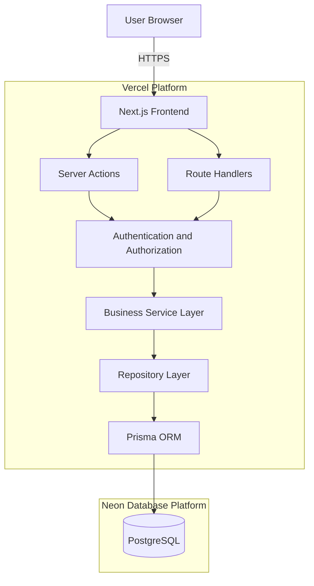
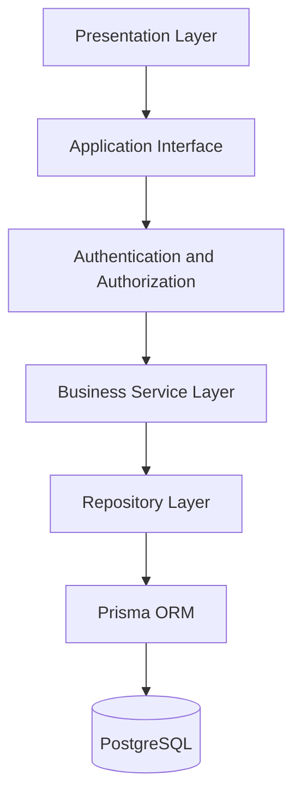
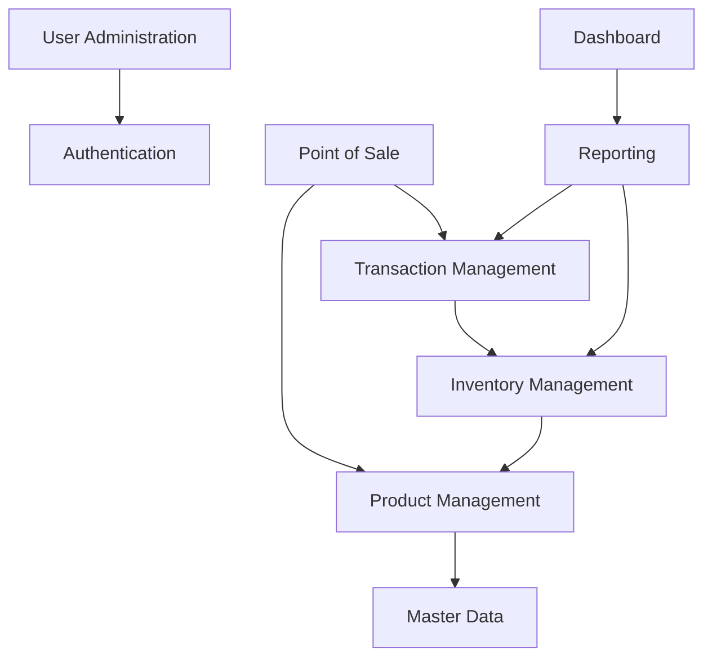
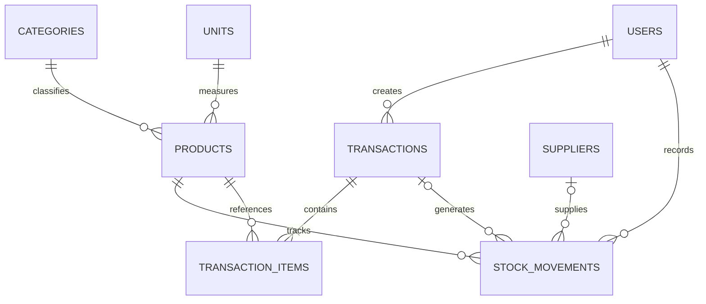
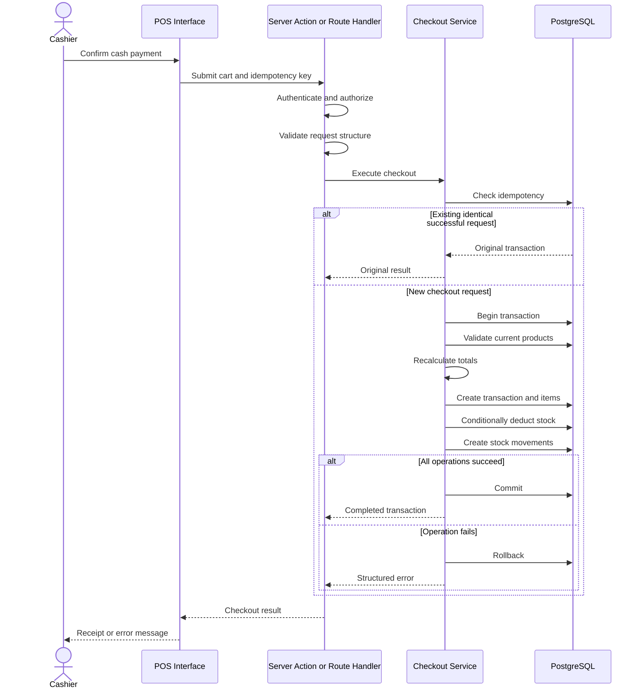
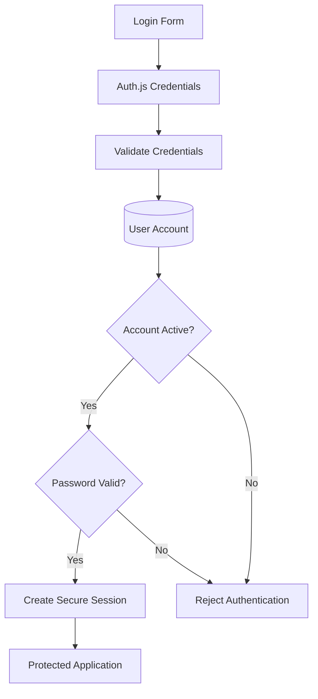
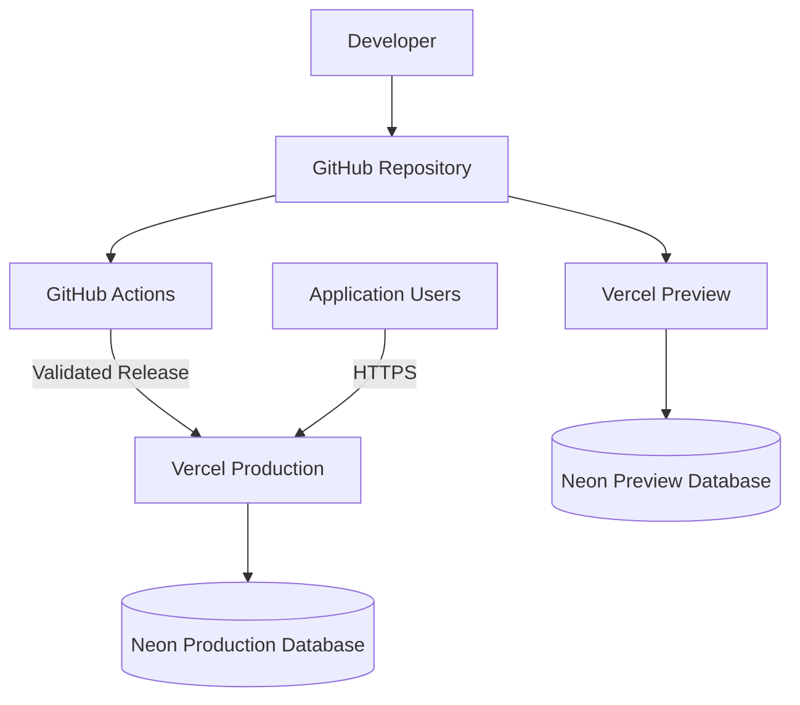
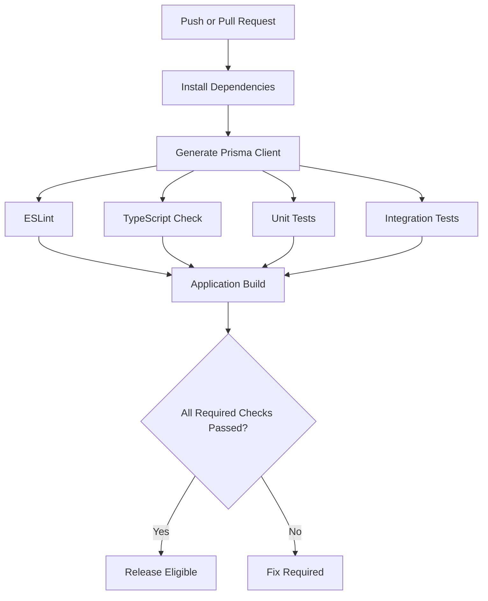
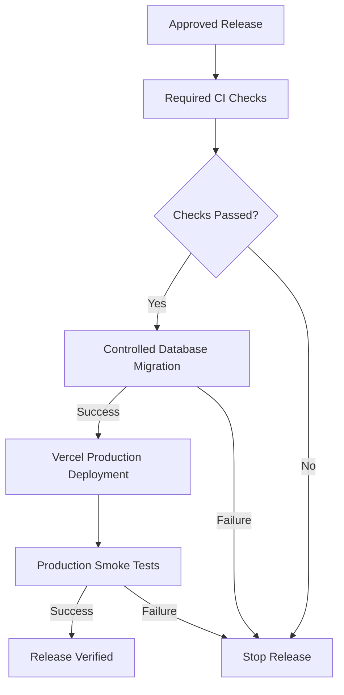
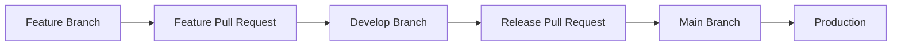

# CashierFlow System Architecture

## 1. Document Information

| Attribute | Description |
|---|---|
| Project | CashierFlow |
| Document Version | 1.0 |
| Product Version | 1.0.0 MVP |
| Author | ZyxxBoy |
| Architecture | Modular Monolith |
| Status | Initial Baseline |

## 2. Architecture Overview

CashierFlow uses a modular monolith architecture built with
Next.js, TypeScript, Prisma ORM, and PostgreSQL.

The frontend and backend are maintained within a single
application repository while business logic, database access,
validation, and presentation are separated into logical modules.

This architecture minimizes deployment complexity while
maintaining clear separation of responsibilities.

## 3. Architecture Goals

- Maintain a simple deployment model.
- Separate business logic from presentation.
- Improve maintainability and testability.
- Enforce consistent security boundaries.
- Preserve transaction integrity.
- Support future module expansion.
- Support automated testing and CI/CD.
- Avoid unnecessary infrastructure complexity.

## 4. High-Level System Architecture



Server Components may also call authorized server-side services
directly without making unnecessary internal HTTP requests.

Authentication and authorization are logical requirements that
must be enforced for every protected operation.

## 5. Technology Stack

### 5.1 Frontend

| Technology | Responsibility |
|---|---|
| Next.js App Router | Application routing and rendering |
| React | UI implementation |
| TypeScript | Static typing |
| Tailwind CSS | Styling |
| shadcn/ui | Reusable components |
| React Hook Form | Form state management |
| Zod | Input validation |
| Zustand | POS shopping cart state |
| Recharts | Optional dashboard visualization |

### 5.2 Backend

| Technology | Responsibility |
|---|---|
| Next.js Server Actions | Internal application mutations |
| Next.js Route Handlers | HTTP endpoints and integrations |
| Auth.js | Authentication and session management |
| Zod | Server-side request validation |
| Prisma | Database access |
| PostgreSQL | Persistent relational data |

### 5.3 Testing

| Technology | Responsibility |
|---|---|
| ESLint | Static analysis |
| Prettier | Code formatting |
| TypeScript | Type checking |
| Vitest | Unit and integration testing |
| Playwright | End-to-end testing |

### 5.4 Infrastructure

| Technology | Responsibility |
|---|---|
| GitHub | Source code management |
| GitHub Actions | Continuous Integration |
| Vercel | Application deployment |
| Neon | Managed PostgreSQL |
| Docker | Local development and containerization |
| Vercel Logs | Basic runtime observability |

## 6. Application Layer Architecture



### 6.1 Presentation Layer

Responsibilities:

- Application pages.
- Layouts and navigation.
- UI components.
- Forms.
- Client-side interaction.
- Loading and error states.
- Shopping cart interaction.

The presentation layer must not directly access the database
from Client Components.

### 6.2 Application Interface Layer

Responsibilities:

- Server Actions.
- Route Handlers.
- Request and response handling.
- Request validation.
- Authentication and authorization checks.
- Delegation to business services.

Interfaces should not contain complex transaction logic.

### 6.3 Business Service Layer

Responsibilities:

- Business rule enforcement.
- Product validation.
- Inventory calculations.
- Transaction calculations.
- Checkout orchestration.
- Authorization-sensitive business operations.
- Transaction boundaries.

The service layer contains the primary application logic.

### 6.4 Repository Layer

Responsibilities:

- Database queries.
- Data persistence.
- Filtering and pagination.
- Conditional inventory updates.
- Transaction-aware database operations.

Repositories must support receiving a transaction-scoped
Prisma client when participating in atomic operations.

### 6.5 Database Layer

Responsibilities:

- Persistent data storage.
- Primary key constraints.
- Foreign key relationships.
- Unique constraints.
- Check constraints.
- Database indexes.
- Atomic transactions.

## 7. Proposed Project Structure

The following structure will be introduced progressively
during implementation.

```text
cashierflow/
├── .github/
│   └── workflows/
│       └── ci.yml
├── docs/
│   ├── BRD.md
│   ├── PRD.md
│   ├── functional-requirements.md
│   ├── non-functional-requirements.md
│   ├── business-rules.md
│   ├── user-stories.md
│   ├── mvp-scope.md
│   ├── architecture.md
│   ├── erd.md
│   ├── data-dictionary.md
│   ├── crud-matrix.md
│   └── rbac-matrix.md
├── prisma/
│   ├── schema.prisma
│   ├── migrations/
│   └── seed.ts
├── public/
├── src/
│   ├── app/
│   │   ├── (auth)/
│   │   │   └── login/
│   │   ├── (dashboard)/
│   │   │   ├── dashboard/
│   │   │   ├── pos/
│   │   │   ├── master-data/
│   │   │   ├── inventory/
│   │   │   ├── transactions/
│   │   │   ├── reports/
│   │   │   ├── administration/
│   │   │   ├── settings/
│   │   │   └── layout.tsx
│   │   ├── api/
│   │   │   ├── auth/
│   │   │   ├── v1/
│   │   │   └── health/
│   │   ├── globals.css
│   │   ├── layout.tsx
│   │   └── page.tsx
│   ├── components/
│   │   ├── ui/
│   │   ├── layouts/
│   │   └── shared/
│   ├── features/
│   │   ├── auth/
│   │   ├── dashboard/
│   │   ├── products/
│   │   ├── categories/
│   │   ├── units/
│   │   ├── suppliers/
│   │   ├── customers/
│   │   ├── inventory/
│   │   ├── pos/
│   │   ├── transactions/
│   │   ├── reports/
│   │   └── users/
│   ├── server/
│   │   ├── actions/
│   │   ├── services/
│   │   ├── repositories/
│   │   └── authorization/
│   ├── schemas/
│   ├── hooks/
│   ├── stores/
│   ├── types/
│   ├── constants/
│   ├── config/
│   ├── lib/
│   │   ├── prisma.ts
│   │   ├── errors.ts
│   │   ├── logger.ts
│   │   └── utils.ts
│   └── auth.ts
├── tests/
│   ├── unit/
│   ├── integration/
│   └── e2e/
├── .env.example
├── .gitignore
├── Dockerfile
├── docker-compose.yml
├── eslint.config.mjs
├── next.config.ts
├── package.json
├── package-lock.json
├── playwright.config.ts
├── tsconfig.json
├── vitest.config.ts
└── README.md
```

Optional modules should not be created prematurely.

The exact framework configuration files will be determined by
the dependency versions selected during project initialization.

## 8. Module Architecture



All protected modules depend on the shared authentication
and authorization mechanisms.

Modules should communicate through well-defined services
rather than directly modifying each other's database records.

## 9. Preliminary Database Architecture

PostgreSQL is used as the primary relational database.

### 9.1 Proposed Core Entities

| Entity | Responsibility |
|---|---|
| users | Application user accounts |
| categories | Product classification |
| units | Product units |
| products | Product information and current stock |
| suppliers | Supplier information |
| stock_movements | Inventory movement history |
| transactions | Completed sales and cash payment summaries |
| transaction_items | Purchased products and historical values |

### 9.2 Optional Entities

| Entity | Responsibility |
|---|---|
| customers | Customer information |
| activity_logs | General user activity history |
| store_settings | Store and receipt configuration |

The MVP uses predefined roles. A database enum or equivalent
constrained role field is sufficient initially.

A separate custom-role and permission-management schema is
not required for the first release.

Auth.js-related tables may be introduced if required by the
selected authentication and session strategy.

### 9.3 Preliminary Entity Relationships



This is a conceptual overview, not the final physical ERD.

The complete database design, column definitions, constraints,
indexes, and referential actions will be finalized on Day 02.

## 10. Data Integrity Strategy

The system must enforce the following constraints:

- Primary keys for persistent entities.
- Foreign keys for related records.
- Unique normalized email addresses.
- Unique normalized product SKUs.
- Unique non-empty barcodes.
- Unique invoice numbers.
- Non-negative product stock.
- Positive sale quantities.
- Positive selling prices.
- Non-negative purchase costs.
- Unique user-scoped idempotency keys.

Database constraints that are not represented directly by the
ORM schema must be added through reviewed SQL migrations.

## 11. Checkout Transaction Architecture



### 11.1 Atomicity

Checkout uses a Prisma interactive database transaction.

The transaction boundary includes:

- Transaction creation.
- Transaction item creation.
- Payment information.
- Inventory deductions.
- Stock movement records.
- Idempotency information.

Any failed operation must roll back the complete checkout.

### 11.2 Concurrency Control

Inventory updates must not use an unprotected
read-then-write approach.

The implementation must:

1. Validate current product information.
2. Use conditional inventory updates that verify stock
   availability at the time of modification.
3. Check affected row counts.
4. Abort the transaction if stock becomes insufficient.
5. Process product identifiers in deterministic order.
6. Handle transaction conflicts and deadlocks safely.
7. Retry only appropriate transient failures within
   bounded retry limits.

Concurrent price and product-status changes must also be
handled through appropriate transaction isolation, locking,
or version checks.

### 11.3 Idempotency

Each intended checkout receives a unique client-generated key.

The database enforces uniqueness for the combination of
requesting user and idempotency key.

An identical successful request returns the original result.

Different request data using the same key returns a conflict.

Any concurrent unique-key collision must be reconciled
against the already committed checkout before replying.

## 12. Authentication Architecture



Authentication requirements:

- Credentials-based login.
- Secure password hashing.
- Secure session management.
- No public self-registration.
- Initial Owner account provisioned through a controlled seed.
- Server-side user status and permission validation.

The selected session strategy must support effective account
deactivation and role changes.

## 13. Authorization Architecture

The application uses Role-Based Access Control.

### Supported Roles

- OWNER
- ADMIN
- CASHIER

Every protected operation follows this logical sequence:

1. Validate authentication.
2. Resolve the current active user.
3. Resolve the user's effective role.
4. Check operation permission.
5. Check resource ownership where required.
6. Execute business logic.

UI visibility is not a security boundary.

Restricted database fields must be excluded from unauthorized
server responses, including serialized Server Component data.

## 14. API and Server Action Strategy

The application uses both Server Actions and Route Handlers.

### Server Actions

Used primarily for:

- Form submissions.
- Master data mutations.
- User administration.
- Inventory operations.

### Route Handlers

Used where explicit HTTP interfaces are useful:

- Checkout requests when exposing a dedicated HTTP endpoint.
- POS product search.
- Report downloads.
- Health checks.
- Future external integrations.

There is no requirement to expose every internal feature
through a REST endpoint.

Both interfaces must reuse the same business service layer.

### Proposed HTTP Endpoints

| Method | Endpoint | Responsibility |
|---|---|---|
| GET | /api/health | Application liveness |
| GET | /api/v1/products/search | Search permitted POS products |
| POST | /api/v1/transactions/checkout | Submit checkout |
| GET | /api/v1/transactions/:id | Retrieve authorized transaction |
| GET | /api/v1/reports/sales/export | Export sales report |

The export endpoint is optional.

Exact endpoint contracts will be finalized during implementation.

### Example Successful Response

```json
{
  "success": true,
  "data": {
    "invoiceNumber": "CF-20261120-8F42A1",
    "total": 45000,
    "cashReceived": 50000,
    "change": 5000
  }
}
```

### Example Error Response

```json
{
  "success": false,
  "error": {
    "code": "INSUFFICIENT_STOCK",
    "message": "The requested quantity exceeds available stock."
  }
}
```

## 15. State Management Strategy

| State Type | Approach |
|---|---|
| Server-rendered data | React Server Components |
| Form state | React Hook Form |
| Validation | Zod |
| Shopping cart | Zustand |
| Local UI state | React state |
| Filters and pagination | URL search parameters |
| Authentication state | Auth.js |

Client-side shopping cart state is temporary and is not
the authoritative source of prices or inventory.

Dynamic authenticated data must not be cached across users
in a way that exposes private information.

## 16. Deployment Architecture



The diagram represents the intended release-gated architecture.

Preview deployments may occur before CI completion.

### Environment Definitions

| Environment | Purpose | Database |
|---|---|---|
| Development | Local implementation | Local or isolated development DB |
| Preview | Feature validation | Isolated preview DB |
| Production | Public MVP demo | Production demo DB |
| CI Test | Automated testing | Ephemeral test DB |

Production credentials must not be used for preview or
automated testing.

## 17. Continuous Integration

GitHub Actions validates changes before release.



Required CI operations:

1. Check out repository.
2. Configure the Node.js runtime.
3. Install locked dependencies.
4. Generate the Prisma client.
5. Run ESLint.
6. Run TypeScript checks.
7. Run unit tests.
8. Run integration tests using an isolated PostgreSQL database.
9. Build the application.
10. Report workflow results.

Critical Playwright E2E scenarios must pass before release,
either in CI or through an explicitly verified release job.

The initial workflow will be introduced on Day 04 and extended
as testable application modules become available.

## 18. Continuous Deployment

### Initial Deployment Strategy

Vercel Git Integration is used for:

- Feature branch preview deployments.
- Development integration previews.
- Production deployment from the main branch.

Required GitHub status checks should protect the main branch
where supported by the repository configuration.

The initial strategy is only release-gated if merges and direct
pushes are appropriately restricted.

Without those restrictions, the developer must explicitly
verify CI results before merging or deploying production code.

### Advanced Deployment Strategy

The advanced workflow will use GitHub Actions and the Vercel CLI
to make production deployment depend on successful test jobs.



The advanced workflow will replace or appropriately disable
the automatic production deployment path to avoid conflicting
duplicate deployments.

## 19. Git Branching Strategy

| Branch | Purpose |
|---|---|
| main | Production-ready releases |
| develop | Feature integration |
| feature/* | New features |
| fix/* | Bug fixes |
| hotfix/* | Urgent production fixes |

### Development Lifecycle



### Conventional Commits

| Type | Usage |
|---|---|
| feat | New functionality |
| fix | Bug fixes |
| docs | Documentation |
| refactor | Internal code restructuring |
| test | Automated tests |
| ci | CI/CD configuration |
| chore | Maintenance tasks |
| perf | Performance improvements |
| build | Build configuration |

Example commits:

    docs: add business requirements document
    feat: implement product management
    feat: implement atomic checkout
    test: add concurrent checkout tests
    ci: configure github actions workflow
    fix: prevent unauthorized transaction access

## 20. Environment Configuration

### Proposed Variables

| Variable | Purpose |
|---|---|
| DATABASE_URL | Runtime PostgreSQL connection |
| AUTH_SECRET | Auth.js session secret |
| APP_URL | Application base URL where required |
| STORE_TIMEZONE | Default store timezone |
| SEED_OWNER_EMAIL | Initial Owner provisioning |
| SEED_OWNER_PASSWORD | Initial Owner provisioning |

A separate direct database connection may be configured for
migrations depending on Prisma and Neon integration.

The exact environment variable names and database configuration
will be finalized during Day 03 and Day 04.

All real secrets must be stored in local ignored environment
files, GitHub Secrets, or Vercel environment configuration.

Only non-sensitive examples may be committed.

## 21. Database Migration Strategy

- Store schema changes in Git.
- Create migrations in the development environment.
- Review generated SQL.
- Test migrations against isolated databases.
- Apply production migrations through controlled release jobs.
- Avoid destructive schema changes where possible.
- Prefer backward-compatible schema changes.
- Verify database recovery options before high-risk migrations.

Typical migration commands:

```bash
npx prisma migrate dev
npx prisma migrate deploy
```

The production application must not run development migrations.

Migrations must not execute automatically on every serverless
application request.

Application rollback does not automatically reverse database
schema changes.

## 22. Testing Architecture

### Unit Testing

Test isolated business logic:

- Transaction calculations.
- Discount validation.
- Payment validation.
- Stock validation.
- Report calculations.
- Role permission checks.

### Integration Testing

Test application services against an isolated PostgreSQL database:

- Product persistence.
- Inventory movements.
- Atomic checkout.
- Transaction rollback.
- Unique constraints.
- Idempotency.
- Concurrent stock updates.

### End-to-End Testing

Test critical user journeys:

- Successful login.
- Unauthorized access rejection.
- Product creation.
- Inventory updates.
- Successful POS checkout.
- Insufficient payment rejection.
- Transaction receipt viewing.

## 23. Security Architecture

Security controls include:

- HTTPS.
- Secure password hashing.
- Secure authentication sessions.
- Server-side RBAC.
- Resource ownership checks.
- Zod input validation.
- Parameterized database operations.
- Appropriate CSRF protections.
- Login and sensitive-operation rate limiting.
- Safe error responses.
- Dependency security review.
- Environment variable isolation.
- Restricted public demo access.

Rate limiting must not rely exclusively on per-instance memory
in a serverless environment.

## 24. Error Handling Strategy

The system distinguishes:

- Validation errors.
- Authentication errors.
- Authorization errors.
- Resource-not-found errors.
- Business rule violations.
- Transaction conflicts.
- Infrastructure errors.

Expected business errors return safe, structured responses.

Unexpected errors are logged on the server without exposing
internal database details or credentials to clients.

## 25. Logging and Monitoring

The MVP uses:

- Structured server-side error logs.
- Vercel deployment logs.
- Vercel runtime logs.
- GitHub Actions workflow logs.
- Application health checks.

The health endpoint reports application liveness without
exposing private infrastructure details.

A separate readiness check may be added if required.

Advanced observability platforms are outside the initial scope.

## 26. Docker Strategy

Docker is intended for local development, reproducible testing,
and future deployment portability.

Docker Compose may include:

- Next.js application.
- PostgreSQL development database.

Vercel deployment does not require the application Dockerfile.

Container-based production deployment can be introduced later
without changing the core business architecture.

## 27. Architecture Decisions

| ID | Decision | Rationale |
|---|---|---|
| ADR-001 | Modular Monolith | Simple deployment and development |
| ADR-002 | Next.js Fullstack | Unified frontend and backend |
| ADR-003 | PostgreSQL | Relational integrity and transactions |
| ADR-004 | Prisma ORM | Type-safe database access and migration workflow |
| ADR-005 | Auth.js | Established authentication integration |
| ADR-006 | Zustand | Lightweight shopping cart state |
| ADR-007 | Neon | Managed PostgreSQL for initial deployment |
| ADR-008 | Vercel | Preview and production web deployment |
| ADR-009 | GitHub Actions | Automated quality checks |
| ADR-010 | Integer IDR | Avoid floating-point monetary errors |
| ADR-011 | Atomic Checkout | Prevent partial sales and inconsistent stock |
| ADR-012 | Single Store | Maintain realistic MVP scope |
| ADR-013 | Predefined Roles | Reduce authorization complexity |
| ADR-014 | Cost Snapshots | Preserve historical gross profit estimates |
| ADR-015 | No Microservices | Avoid premature distributed complexity |

## 28. Architectural Trade-offs

### Modular Monolith

Advantages:

- Lower infrastructure complexity.
- Simpler local development.
- Easier transaction coordination.
- Faster initial delivery.

Limitations:

- Modules share application deployment.
- Independent module scaling is limited.
- Architectural boundaries require developer discipline.

### Serverless Deployment

Advantages:

- Simple initial deployment.
- Managed application infrastructure.
- Preview environments.
- Low initial operational cost.

Limitations:

- Potential cold starts.
- Execution and resource limits.
- Database connection management requirements.
- Limited suitability for persistent background processes.

### ORM-Based Data Access

Advantages:

- Type-safe queries.
- Consistent database access.
- Integrated migration workflow.

Limitations:

- Complex SQL may require explicit queries.
- Generated queries must be reviewed for performance.
- Some database constraints require custom SQL migrations.

## 29. Future Architecture Considerations

The application may later support:

- Multi-store isolation.
- Payment gateway webhooks.
- Dedicated distributed rate limiting.
- Redis caching.
- Background job processing.
- Object storage.
- Real-time notifications.
- Container-based hosting.
- Advanced logging and monitoring.

These components should be introduced only when justified
by actual product or operational requirements.

## 30. Related Documents

- [Business Requirements](BRD.md)
- [Product Requirements](PRD.md)
- [Functional Requirements](functional-requirements.md)
- [Non-Functional Requirements](non-functional-requirements.md)
- [Business Rules](business-rules.md)
- [User Stories](user-stories.md)
- [MVP Scope](mvp-scope.md)
