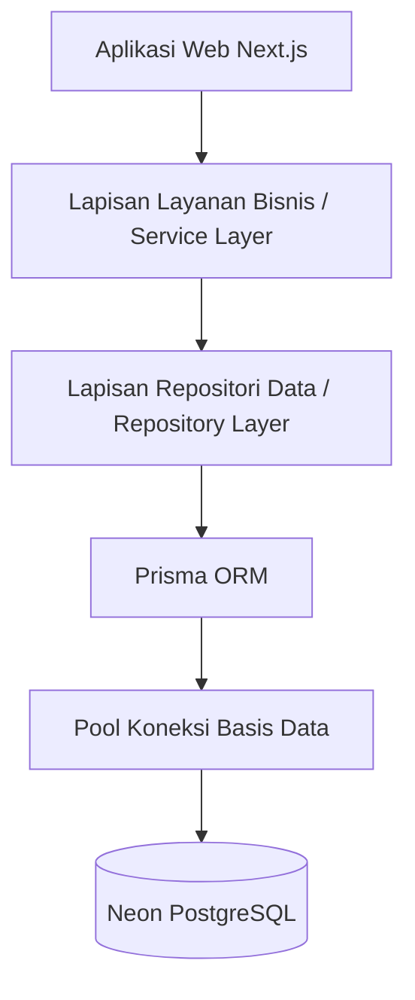

# Spesifikasi Perancangan Basis Data (Database Design Specification)

## 1. Informasi Dokumen

| Atribut | Nilai |
|---|---|
| Proyek | CashierFlow |
| Versi Dokumen | 1.0 |
| Mesin Basis Data | PostgreSQL |
| Hosting Basis Data | Neon |
| ORM | Prisma |
| Penulis | ZyxxBoy |
| Status | Design Baseline |

## 2. Sasaran Perancangan

- Memelihara integritas data relasional secara mutlak.
- Mencegah timbulnya data kuantitas inventaris yang tidak konsisten.
- Mempertahankan keutuhan data historis transaksi penjualan masa lalu.
- Mendukung pemrosesan transaksi penjualan yang aman dari konflik konkurensi.
- Mencegah terjadinya transaksi ganda akibat request checkout berulang (idempotensi).
- Mendukung query pembacaan data yang cepat dan efisien.
- Menjaga keamanan akses terhadap data finansial dan operasional bisnis.
- Mendukung migrasi skema basis data otomatis yang terkelola.
- Mendukung isolasi lingkungan pengembangan lokal, preview, dan pengujian CI.

## 3. Arsitektur Basis Data



## 4. Strategi Pemodelan Data

Perancangan basis data mengikuti tiga tahapan pemodelan:

### Model Konseptual (Conceptual Model)

Mendefinisikan entitas-entitas bisnis utama:

- Pengguna (`users`).
- Produk (`products`).
- Kategori (`categories`).
- Satuan (`units`).
- Pemasok (`suppliers`).
- Pelanggan (`customers`).
- Mutasi Stok (`stock_movements`).
- Transaksi (`transactions`).
- Item Transaksi (`transaction_items`).

### Model Logikal (Logical Model)

Mendefinisikan:

- Atribut-atribut data.
- Kunci utama (Primary Keys).
- Kunci asing (Foreign Keys).
- Hubungan relasi antar entitas.
- Derajat kardinalitas (1:N, 0..1:N).
- Derajat normalisasi.
- Aturan validasi dan konstrain bisnis.

### Model Fisikal (Physical Model)

Mendefinisikan:

- Nama tabel fisik PostgreSQL.
- Tipe data kolom PostgreSQL.
- Konstrain SQL (Primary Key, Unique, Check, Not Null).
- Indeks basis data B-tree.
- Aksi referensial (On Delete RESTRICT).
- Penanganan transaksi dan konkurensi (Row-Level Locking).
- Konfigurasi migrasi Prisma.

Atribut-atribut fisik proposal didefinisikan secara mendalam pada dokumen Kamus Data.

## 5. Normalisasi Basis Data

Model data master relasional dirancang mengikuti prinsip normalisasi hingga Bentuk Normal Ketiga (3NF) jika memungkinkan.

### Bentuk Normal Pertama (1NF)

- Seluruh nilai kolom bersifat atomik (tidak ada array atau string yang digabungkan).
- Daftar produk tidak disimpan dalam satu kolom teks yang dipisahkan tanda koma.
- Setiap item transaksi yang dibeli disimpan sebagai baris terpisah pada tabel rincian item.

### Bentuk Normal Kedua (2NF)

- Seluruh atribut non-kunci bergantung penuh pada primary key entitasnya.
- Informasi rincian item transaksi dipisahkan dari tabel induk transaksi (header).
- Informasi master produk dipisahkan dari rincian item transaksi.

### Bentuk Normal Ketiga (3NF)

- Data kategori disimpan terpisah dari tabel produk.
- Data satuan unit disimpan terpisah dari tabel produk.
- Data pemasok disimpan terpisah dari rekaman mutasi inventaris.
- Data profil pengguna disimpan terpisah dari tabel transaksi.

## 6. Denormalisasi Terencana (Intentional Denormalization)

Beberapa kolom secara sengaja diduplikasi atau diturunkan nilainya demi menjaga integritas historis dan meningkatkan efisiensi pembacaan data.

| Kolom | Alasan Denormalisasi |
|---|---|
| products.stock | Membaca stok barang saat ini dengan cepat tanpa harus melakukan agregasi `SUM()` setiap saat |
| transactions.subtotal | Mempertahankan keutuhan nominal subtotal saat transaksi diselesaikan |
| transactions.total | Mempertahankan keutuhan nominal total akhir transaksi |
| transactions.total_cost | Menghitung laba kotor historis dengan cepat tanpa perlu join berlebih |
| transaction_items.product_name | Mempertahankan identitas nama produk pada saat transaksi terjadi |
| transaction_items.product_sku | Mempertahankan identitas SKU produk pada saat transaksi terjadi |
| transaction_items.unit_name | Mempertahankan nama satuan produk pada saat transaksi terjadi |
| transaction_items.unit_price | Mempertahankan harga jual resmi pada saat transaksi terjadi |
| transaction_items.unit_cost | Mempertahankan harga modal/pokok produk pada saat transaksi terjadi |
| transaction_items.subtotal | Mempertahankan nilai nominal baris item belanja |

Nilai-nilai ini wajib ditulis secara konsisten di dalam satu transaksi basis data yang atomik.

## 7. Strategi Primary Key

Seluruh tabel bisnis inti menggunakan tipe data UUID sebagai Primary Key.

Kelebihan:

- Identifier dapat digenerate secara mandiri di sisi klien atau server.
- Risiko tabrakan ID hampir mustahil terjadi.
- Nilai ID tidak dapat ditebak secara berurutan (*non-sequential*) sehingga lebih aman.
- Mendukung integrasi sistem terdistribusi di masa depan.

Keterbatasan:

- Ukuran indeks lebih besar dibandingkan tipe integer sekuensial.
- UUID acak dapat mengurangi lokalisasi penyisipan pohon indeks B-tree.

Sistem MVP memanfaatkan fungsi bawaan PostgreSQL `gen_random_uuid()` untuk menghasilkan UUID v4.

Penggunaan UUID tidak menggantikan kewajiban pemeriksaan autentikasi dan kepemilikan data di sisi server.

Tabel `store_settings` merupakan pengecualian dan menggunakan primary key integer tetap bernilai 1 (*singleton*).

## 8. Strategi Data Finansial

Nilai nominal keuangan disimpan dalam format bilangan bulat Rupiah (IDR) menggunakan tipe data PostgreSQL `BIGINT`.

Contoh:

| Nominal Ditampilkan | Nilai Disimpan di Basis Data |
|---|---:|
| Rp15.000 | 15000 |
| Rp125.500 | 125500 |
| Rp1.000.000 | 1000000 |

Tipe data pecahan atau floating-point dilarang keras digunakan untuk kalkulasi keuangan.

Kalkulasi aritmetika pada kode aplikasi menggunakan objek native `BigInt`.

Batas nilai moneter maksimum yang dapat disimpan adalah:

    1.000.000.000.000 IDR (1 Triliun Rupiah)

Seluruh nilai nominal akhir wajib divalidasi terhadap batas domain sebelum disimpan dan diserialisasi ke format JSON.

Nilai moneter yang dikembalikan melalui HTTP endpoints dapat dikonversi ke tipe number JavaScript biasa hanya setelah dipastikan aman berada di dalam rentang `Number.MAX_SAFE_INTEGER`.

## 9. Strategi Timestamp

Seluruh pencatatan waktu bisnis menggunakan tipe data `TIMESTAMPTZ` (sadar zona waktu).

PostgreSQL menyimpan titik waktu absolut dalam UTC, sementara format zona waktu tampilan diatur oleh konfigurasi aplikasi.

Zona waktu default toko:

    Asia/Jakarta (WIB)

Sesi koneksi basis data harus selalu diset ke UTC untuk konsistensi serialisasi.

Contoh:

    Waktu tersimpan di database: 2026-11-20T03:00:00Z
    Waktu ditampilkan di toko:    2026-11-20 10:00:00 WIB

Batas rentang tanggal untuk laporan harian dan bulanan wajib dihitung berdasarkan zona waktu toko yang dikonfigurasi, lalu dikonversi menjadi titik waktu absolut UTC.

Gunakan rentang waktu setengah terbuka (*half-open interval*):

    created_at >= period_start
    created_at < period_end

Hindari mengandalkan zona waktu lokal server hosting.

## 10. Integritas Referensial

| Tabel Anak (Child) | Foreign Key | Tabel Induk (Parent) | Aksi On Delete |
|---|---|---|---|
| products | category_id | categories | RESTRICT |
| products | unit_id | units | RESTRICT |
| transactions | cashier_id | users | RESTRICT |
| transactions | customer_id | customers | RESTRICT |
| transaction_items | transaction_id | transactions | RESTRICT |
| transaction_items | product_id | products | RESTRICT |
| stock_movements | product_id | products | RESTRICT |
| stock_movements | supplier_id | suppliers | RESTRICT |
| stock_movements | transaction_id | transactions | RESTRICT |
| stock_movements | created_by | users | RESTRICT |
| activity_logs | user_id | users | RESTRICT |

Identifier rekaman data bersifat abadi (immutable).

Referensi data historis harus tetap dapat diakses meskipun entitas master telah dinonaktifkan.

Aksi penghapusan berantai (*cascade delete*) dilarang keras digunakan untuk riwayat transaksi finansial maupun pergerakan stok barang.

## 11. Konstrain Basis Data

### Primary Keys

Setiap tabel wajib memiliki Primary Key.

### Konstrain Unik (Unique Constraints)

| Tabel | Kolom |
|---|---|
| users | email |
| categories | name |
| units | name |
| units | code |
| products | sku |
| products | barcode |
| transactions | invoice_number |
| transactions | cashier_id, idempotency_key |
| transaction_items | transaction_id, product_id |

Barcode opsional yang tidak diisi wajib menggunakan nilai NULL.

Data email, SKU, dan identitas master lainnya wajib dinormalisasi sebelum disimpan ke basis data.

### Konstrain Pemeriksaan (CHECK Constraints)

| Tabel | Validasi yang Diwajibkan |
|---|---|
| products | selling_price > 0 |
| products | purchase_cost >= 0 |
| products | stock >= 0 |
| products | minimum_stock >= 0 |
| stock_movements | quantity_change != 0 |
| stock_movements | stock_before >= 0 |
| stock_movements | stock_after >= 0 |
| stock_movements | stock_after = stock_before + quantity_change |
| transactions | subtotal > 0 |
| transactions | discount >= 0 |
| transactions | discount < subtotal |
| transactions | total = subtotal - discount |
| transactions | cash_received >= total |
| transactions | change_amount = cash_received - total |
| transactions | total_cost >= 0 |
| transaction_items | quantity > 0 |
| transaction_items | unit_price > 0 |
| transaction_items | unit_cost >= 0 |
| transaction_items | subtotal = quantity * unit_price |
| store_settings | id = 1 |

Seluruh batas numerik ini wajib ditegakkan baik melalui validasi skema di sisi server (Zod) maupun melalui konstrain ketat di tingkat basis data.

## 12. Strategi Pengindeksan Basis Data

### Sasaran Pengindeksan

- Mempercepat pencarian produk di kasir.
- Mempercepat filter transaksi berdasarkan rentang tanggal.
- Mempercepat pembacaan riwayat transaksi per kasir.
- Mempercepat penelusuran riwayat mutasi stok barang.
- Mempercepat pencarian data relasional melalui Foreign Key.

### Rencana Indeks

| Tabel | Kolom yang Diindeks | Alasan / Pola Query |
|---|---|---|
| users | email | Pencarian login unik |
| products | sku | Pencarian tepat berdasarkan SKU |
| products | barcode | Pencarian tepat berdasarkan Barcode |
| products | category_id | Filter produk berdasarkan kategori |
| products | unit_id | Pencarian foreign key satuan |
| transactions | invoice_number | Pencarian faktur penjualan |
| transactions | created_at | Filter laporan rentang tanggal |
| transactions | cashier_id, created_at | Riwayat transaksi kasir tertentu |
| transactions | customer_id | Pencarian transaksi pelanggan |
| transaction_items | transaction_id, product_id | Keunikan item transaksi |
| transaction_items | product_id | Analitik penjualan per produk |
| stock_movements | product_id, created_at | Riwayat mutasi per produk |
| stock_movements | supplier_id | Penelusuran barang masuk dari pemasok |
| stock_movements | transaction_id | Penelusuran mutasi dari faktur penjualan |
| stock_movements | created_by | Keterlacakan pengguna pembuat mutasi |
| stock_movements | created_at | Filter periode waktu mutasi stok |
| activity_logs | user_id, created_at | Riwayat aktivitas per pengguna |
| activity_logs | created_at | Filter riwayat aktivitas umum |

Konstrain Primary Key dan Unique secara otomatis menghasilkan indeks pendukung di PostgreSQL.

Kolom Foreign Key tidak secara otomatis diindeks di PostgreSQL, sehingga penambahan indeks eksplisit diperlukan untuk kolom relasi penting.

## 13. Arsitektur Inventaris

Basis data menggunakan model ganda: **Stok Saat Ini** (*Current Stock*) dan **Buku Besar Mutasi** (*Movement Ledger*).

### Stok Saat Ini

    products.stock

Menyediakan data ketersediaan barang secara instan untuk kebutuhan operasional kasir.

### Buku Besar Mutasi

    stock_movements

Menyediakan catatan historis perubahan stok yang bersifat abadi (*immutable*).

Kondisi rekonsiliasi yang wajib terpenuhi:

    products.stock = SUM(stock_movements.quantity_change)

Setiap produk baru dimulai dengan stok nol (0). Setiap perubahan stok berikutnya wajib menghasilkan satu rekaman mutasi stok yang bersesuaian.

## 14. Contoh Alur Mutasi Inventaris

| Jenis Mutasi | Stok Sebelum | Selisih Mutasi | Stok Sesudah |
|---|---:|---:|---:|
| STOCK_IN (Penerimaan Awal) | 0 | +20 | 20 |
| SALE (Penjualan Kasir) | 20 | -3 | 17 |
| STOCK_IN (Pasokan Tambahan) | 17 | +10 | 27 |
| STOCK_OUT (Barang Rusak) | 27 | -2 | 25 |
| ADJUSTMENT (Selisih Opname) | 25 | -1 | 24 |

Sisa stok akhir produk adalah 24 unit. Total penjumlahan seluruh mutasi stok bertanda (+/-) juga tepat bernilai 24.

## 15. Strategi Transaksi Basis Data

Proses transaksi checkout kasir wajib memenuhi prinsip ACID:

| Prinsip | Penerapan dalam CashierFlow |
|---|---|
| Atomicity | Seluruh operasi checkout berhasil di-commit bersama atau dibatalkan penuh (all-or-nothing) |
| Consistency | Seluruh konstrain basis data dan aturan bisnis menjaga keabsahan data |
| Isolation | Transaksi checkout yang terjadi bersamaan tidak dapat menyebabkan penjualan barang melebihi stok (*overselling*) |
| Durability | Transaksi yang telah berhasil di-commit tersimpan permanen pada penyimpanan persisten |

Operasi yang tercakup di dalam batasan atomik:

- Membuat transaksi induk (header).
- Membuat rincian item transaksi.
- Memotong stok inventaris produk.
- Membuat rekaman mutasi stok (tipe SALE).
- Menyimpan rekaman kunci idempotensi.
- Mencatat log audit checkout jika modul aktif.

## 16. Alur Kerja Transaksi Checkout

```mermaid
flowchart TD
    REQUEST[Permintaan Checkout Kasir]
    VALIDATE[Autentikasi & Validasi Input Zod]
    IDEMPOTENCY{Kunci Idempotensi Sudah Ada?}
    RETURN[Kembalikan Hasil Transaksi Lama atau Konflik]
    BEGIN[Mulai Transaksi Basis Data (BEGIN)]
    LOCK[Kunci Baris Produk Berurutan (SELECT FOR UPDATE)]
    CHECK[Validasi Harga, Status, dan Sisa Stok]
    CALC[Hitung Ulang Nilai Transaksi di Server]
    CREATE[Buat Transaksi Header & Rincian Item]
    UPDATE[Potong Stok Produk Secara Kondisional]
    LOG[Buat Rekaman Mutasi Stok]
    SUCCESS{Semua Operasi Berhasil?}
    COMMIT[Commit Transaksi (COMMIT)]
    ROLLBACK[Batalkan Seluruh Perubahan (ROLLBACK)]
    RECEIPT[Kembalikan Struk Berhasil]
    ERROR[Kembalikan Error Terstruktur]

    REQUEST --> VALIDATE
    VALIDATE --> IDEMPOTENCY
    IDEMPOTENCY -->|Ya| RETURN
    IDEMPOTENCY -->|Tidak| BEGIN
    BEGIN --> LOCK
    LOCK --> CHECK
    CHECK --> CALC
    CALC --> CREATE
    CREATE --> UPDATE
    UPDATE --> LOG
    LOG --> SUCCESS
    SUCCESS -->|Ya| COMMIT
    SUCCESS -->|Tidak| ROLLBACK
    COMMIT --> RECEIPT
    ROLLBACK --> ERROR
```

## 17. Kontrol Konkurensi

Sistem MVP menggunakan tingkat isolasi **READ COMMITTED** di PostgreSQL yang dikombinasikan dengan penguncian baris eksplisit (*Row-Level Locking*) untuk operasi yang menyangkut kuantitas stok barang.

Alur pembaruan stok:

1. Memulai transaksi basis data interaktif Prisma.
2. Mengunci baris produk yang terdampak menggunakan query `SELECT FOR UPDATE`.
3. Mengambil kunci baris dalam urutan deterministik (diurutkan berdasarkan ID produk) untuk mencegah kebuntuan (*deadlock*).
4. Membaca stok terkini, status keaktifan, dan harga jual produk.
5. Memvalidasi seluruh persyaratan transaksi belanja.
6. Menjalankan pembaruan kondisional stok.
7. Membuat rekaman mutasi stok menggunakan nilai stok yang terkunci.
8. Melakukan commit atau rollback transaksi secara utuh.

### Pemotongan Stok Kondisional (SQL)

```sql
UPDATE products
SET
    stock = stock - $1::integer,
    updated_at = CURRENT_TIMESTAMP
WHERE id = $2::uuid
  AND is_active = TRUE
  AND $1::integer > 0
  AND stock >= $1::integer
RETURNING stock;
```

Parameter:

- `$1`: Kuantitas belanja yang dipotong.
- `$2`: UUID produk.

Jika tidak ada baris yang dikembalikan oleh query di atas (affected rows = 0), transaksi checkout wajib dibatalkan dengan aman (*rollback*).

Query ini wajib dieksekusi melalui transaksi klien yang sama dengan pembuatan rekaman penjualan dan mutasi stok.

## 18. Strategi Penanganan Deadlock dan Retry

- Mengunci baris produk dalam urutan yang konsisten (berdasarkan `id` terurut).
- Memastikan durasi transaksi basis data berlangsung sesingkat mungkin.
- Dilarang keras melakukan pemanggilan API jaringan eksternal di dalam blok transaksi basis data.
- Mengidentifikasi error konflik transaksi yang aman untuk diulang (*retryable*).
- Menerapkan strategi retry terbatas hanya untuk kesalahan transien yang telah terkonfirmasi.
- Dilarang melakukan retry otomatis untuk kesalahan validasi bisnis permanen.
- Gunakan kunci idempotensi yang sama saat mengulang checkout akibat kegagalan jaringan transien.

## 19. Strategi Idempotensi

Permintaan checkout kasir memuat:

- ID pengguna terautentikasi (kasir).
- Kunci idempotensi unik berbentuk UUID buatan klien.
- Daftar produk dan kuantitas yang dinormalisasi.
- Ekspektasi harga jual.
- Nominal potongan diskon.
- Nominal uang tunai yang diterima.
- ID pelanggan opsional jika ada.

Server menormalisasi payload dan menghitung hash sidik jari permintaan menggunakan SHA-256.

Tabel `transactions` menegakkan konstrain keunikan:

    UNIQUE (cashier_id, idempotency_key)

Hasil Pengujian Kondisi Permintaan:

| Kondisi Permintaan | Hasil Operasi |
|---|---|
| Kunci baru belum terdaftar | Proses transaksi checkout secara normal |
| Kunci sama dengan payload yang identik | Mengembalikan data transaksi asli yang telah sukses |
| Kunci sama dengan payload yang berbeda | Menolak permintaan dengan error konflik (`IDEMPOTENCY_CONFLICT`) |
| Percobaan checkout sebelumnya terkonfirmasi gagal | Tidak ada transaksi yang tersimpan, dapat mencoba dengan kunci baru |
| Permintaan duplikat terkirim secara bersamaan | Hanya satu transaksi yang berhasil di-commit |
| Hasil koneksi jaringan terputus setelah transaksi | Klien mengulang dengan kunci yang sama untuk melihat hasil asli |

## 20. Proteksi Akun Owner Aktif Terakhir

Sistem wajib mencegah terhapusnya atau dinonaktifkannya akun Owner aktif terakhir.

Pemeriksaan sederhana berupa hitung jumlah lalu perbarui tidak memadai jika terjadi permintaan bersamaan dari dua admin berbeda.

Perubahan peran atau status akun Owner wajib menggunakan transaksi yang mengunci baris atau operasi dengan isolasi ketat yang memverifikasi ulang jumlah akun Owner yang masih aktif sebelum transaksi di-commit.

## 21. Rekonsiliasi Basis Data

Query verifikasi konsistensi stok inventaris:

```sql
SELECT
    p.id,
    p.sku,
    p.stock AS current_stock,
    COALESCE(SUM(sm.quantity_change), 0) AS ledger_stock
FROM products AS p
LEFT JOIN stock_movements AS sm
    ON sm.product_id = p.id
GROUP BY p.id, p.sku, p.stock
HAVING p.stock <> COALESCE(SUM(sm.quantity_change), 0);
```

Hasil yang diharapkan:

    Nol baris (Zero rows).

Jika query di atas menghasilkan baris, hal tersebut menandakan adanya inkonsistensi data stok yang memerlukan investigasi teknis.

Pemeriksaan rekonsiliasi transaksi juga memverifikasi:

- Subtotal transaksi sama dengan penjumlahan subtotal setiap item transaksi.
- Total harga pokok transaksi sama dengan penjumlahan modal setiap item transaksi.
- Setiap transaksi penjualan yang selesai memiliki minimal satu baris item transaksi.
- Setiap baris item transaksi memiliki tepat satu rekaman mutasi stok bertipe SALE yang cocok nilai produk dan kuantitasnya.

## 22. Strategi Lingkungan Basis Data

| Lingkungan | Basis Data yang Digunakan |
|---|---|
| Development Lokal | PostgreSQL lokal (Docker) atau basis data branch Neon terisolasi |
| Preview (PR) | Basis data preview Neon terisolasi |
| Production | Basis data produksi demo Neon |
| CI Testing | Basis data PostgreSQL ephemeral (GitHub Actions service container) |

Kredensial basis data produksi dilarang keras digunakan untuk pengujian lokal maupun lingkungan preview PR.

## 23. Strategi Koneksi Basis Data

Aplikasi yang dideploy ke Vercel menggunakan koneksi basis data PostgreSQL yang terkelola melalui connection pooling (Neon Serverless Driver / Pooled Connection).

Koneksi langsung (direct connection) dapat digunakan untuk eksekusi migrasi skema dan administrasi.

Aturan Operasional:

- Hindari pembuatan instance database client baru pada setiap request.
- Terapkan batas ukuran pool koneksi yang terukur.
- Gunakan konfigurasi connection pooling yang sesuai untuk arsitektur serverless.
- Jaga batas waktu timeout transaksi agar tidak melampaui batas eksekusi serverless hosting.
- Pisahkan kredensial koneksi per masing-masing lingkungan.
- Dilarang keras meng-commit string koneksi basis data ke dalam repositori GitHub.

## 24. Strategi Migrasi Basis Data

Perubahan skema basis data dikelola menggunakan fitur migrasi bawaan Prisma ORM.

Perintah migrasi di lingkungan lokal:

```bash
npx prisma migrate dev --name init
```

Perintah penerapan migrasi di lingkungan produksi:

```bash
npx prisma migrate deploy
```

Aturan Operasional:

- Seluruh berkas migrasi wajib di-commit ke Git.
- Periksa skrip SQL yang dihasilkan sebelum melakukan commit.
- Uji eksekusi migrasi pada basis data pengujian yang terisolasi.
- Terapkan migrasi produksi melalui alur deployment yang terkontrol.
- Hindari perubahan skema yang bersifat destruktif tanpa peninjauan mendalam.
- Dilarang menjalankan perintah `prisma migrate dev` pada lingkungan produksi.
- Dilarang mengeksekusi migrasi otomatis pada setiap siklus request aplikasi web.

## 25. Strategi Data Awal (Seed Data)

Data awal (seed) mencakup:

- Satu akun Owner terkontrol untuk inisialisasi login pertama.
- Akun demo fiktif untuk peran Admin dan Kasir.
- Data kategori produk dasar.
- Data satuan unit barang standar.
- Data pemasok fiktif.
- Data produk-produk fiktif.
- Riwayat mutasi stok awal.
- Konfigurasi bawaan toko jika modul pengaturan telah aktif.

Seluruh data produk baru harus dimulai dengan nilai stok nol (0). Setiap stok awal yang dimasukkan wajib disertai dengan rekaman mutasi stok (tipe STOCK_IN).

Operasi seed harus bersifat idempoten dan dapat dijalankan berulang kali tanpa menduplikasi data atau kuantitas stok.

## 26. Backup dan Pemulihan (Backup & Recovery)

- Manfaatkan fitur pemulihan titik waktu (*Point-in-Time Recovery / branch recovery*) yang disediakan oleh platform Neon.
- Ekspor data penting sebelum menjalankan skrip migrasi yang berisiko tinggi.
- Uji proses pemulihan basis data pada lingkungan terisolasi secara berkala.
- Pahami bahwa melakukan rollback kode aplikasi di Vercel tidak membatalkan perubahan skema atau data pada basis data PostgreSQL.

## 27. Keamanan Basis Data

- Seluruh koneksi ke basis data wajib menggunakan enkripsi TLS/SSL.
- Batasi hak akses kredensial basis data sesuai kebutuhan lingkungan.
- Gunakan parameterized query pada setiap operasi untuk mencegah serangan SQL Injection.
- Seluruh input yang tidak tepercaya wajib divalidasi sebelum menyentuh lapisan basis data.
- Hash kata sandi dilarang disimpan di sisi klien atau diekspos melalui API.
- Terapkan pembatasan hak akses berbasis peran pada data finansial dan modal produk.
- Gunakan data fiktif pada basis data lingkungan portofolio publik.

## 28. Persyaratan Pengujian Basis Data

| ID Pengujian | Skenario Pengujian | Hasil yang Diharapkan |
|---|---|---|
| DB-TST-001 | Memasukkan produk dengan SKU duplikat | Ditolak oleh konstrain unik |
| DB-TST-002 | Memasukkan produk dengan barcode duplikat | Ditolak oleh konstrain unik |
| DB-TST-003 | Memasukkan produk dengan ID kategori yang tidak valid | Ditolak oleh konstrain foreign key |
| DB-TST-004 | Mencoba mengubah stok produk menjadi bernilai negatif | Ditolak oleh konstrain CHECK |
| DB-TST-005 | Memasukkan harga jual produk bernilai 0 atau negatif | Ditolak oleh konstrain CHECK |
| DB-TST-006 | Checkout kasir dengan kuantitas melebihi sisa stok | Dibatalkan penuh (Rollback) |
| DB-TST-007 | Checkout bersamaan pada produk dengan stok terbatas | Tidak terjadi overselling (stok minus) |
| DB-TST-008 | Mengirim ulang checkout dengan kunci idempotensi yang sama | Tidak menghasilkan transaksi ganda |
| DB-TST-009 | Kegagalan saat menyimpan mutasi stok pada proses checkout | Seluruh transaksi di-rollback penuh |
| DB-TST-010 | Mengubah harga jual master produk setelah transaksi selesai | Nilai transaksi historis tidak berubah |
| DB-TST-011 | Menghapus kategori yang telah digunakan oleh produk | Ditolak oleh aturan On Delete RESTRICT |
| DB-TST-012 | Eksekusi query rekonsiliasi stok inventaris | Menghasilkan nol baris selisih |
| DB-TST-013 | Memasukkan transaksi dengan uang tunai kurang dari total tagihan | Ditolak oleh konstrain CHECK |
| DB-TST-014 | Percobaan menonaktifkan akun Owner aktif terakhir secara bersamaan | Akun Owner aktif terakhir tetap terjaga |
| DB-TST-015 | Menjalankan migrasi Prisma pada basis data kosong | Berhasil tanpa error |
| DB-TST-016 | Menjalankan skrip seed berkali-kali | Tidak terjadi duplikasi data atau stok |
| DB-TST-017 | Manipulasi total nilai moneter di luar batas aman | Ditolak oleh validasi sistem |
| DB-TST-018 | Mengubah harga modal master produk di masa kini | Nilai laba kotor transaksi lama tidak berubah |

## 29. Rekaman Keputusan Arsitektur Basis Data (Database ADR)

| ID | Keputusan | Alasan dan Rasional |
|---|---|---|
| DB-ADR-001 | PostgreSQL | Dukungan transaksi ACID yang tangguh dan konstrain relasional yang kuat |
| DB-ADR-002 | Primary Key UUID | Identifier unik yang aman, non-sekuensial, dan dapat digenerate secara independen |
| DB-ADR-003 | Nominal Finansial BIGINT | Menghindari potensi bug presisi desimal (floating-point error) pada mata uang Rupiah |
| DB-ADR-004 | Kolom Waktu TIMESTAMPTZ | Menjamin konsistensi zona waktu dan akurasi titik waktu absolut |
| DB-ADR-005 | Model Stok Saat Ini & Buku Besar Mutasi | Memadukan kecepatan pembacaan kasir dengan keterlacakan mutasi yang abadi |
| DB-ADR-006 | Snapshot Nilai Transaksi Historis | Menjaga keabsahan laporan finansial lampau saat data master produk berubah |
| DB-ADR-007 | Tipe Enum untuk Peran Pengguna | Menyederhanakan kontrol hak akses RBAC untuk ruang lingkup MVP |
| DB-ADR-008 | Data Pembayaran Tunai di Header Transaksi | Menyederhanakan model transaksi ritel kasir tunai tanpa kerumitan tabel pembayaran terpisah |
| DB-ADR-009 | Aksi Referensial RESTRICT | Melindungi data historis transaksi dan inventaris dari penghapusan tidak sengaja |
| DB-ADR-010 | Transaksi Checkout Atomik | Mencegah tersimpannya transaksi parsial dan menjamin konsistensi stok barang |
| DB-ADR-011 | Konstrain Unik Idempotensi | Menjamin keamanan dari transaksi ganda akibat request berulang atau gangguan jaringan |
| DB-ADR-012 | Penguncian Baris (Row-Level Locking) | Mencegah terjadinya race condition dan overselling saat checkout bersamaan |
| DB-ADR-013 | Skrip Migrasi Prisma Terkelola | Memelihara riwayat perubahan skema yang aman dan teruji di Git |
| DB-ADR-014 | Isolasi Lingkungan Basis Data | Melindungi data produksi dari pengaruh pengujian lokal dan deployment preview |
| DB-ADR-015 | Tanpa Dependensi Redis Prematur | Mengurangi kompleksitas infrastruktur pada tahap rilis awal MVP |

## 30. Pengembangan Basis Data Masa Depan

Skema basis data dapat diperluas di masa mendatang untuk mendukung:

- Pengelolaan peran dinamis dan matriks izin granular.
- Multi-toko dan multi-cabang terisolasi.
- Integrasi pembayaran digital QRIS dan payment gateway.
- Manajemen pengembalian dana (refund) dan retur barang.
- Manajemen shift kerja kasir dan laci uang.
- Manajemen Purchase Order (PO) ke pemasok.
- Pelacakan batch/lot barang dan tanggal kedaluwarsa.
- Sistem penilaian persediaan FIFO atau Weighted Average.
- Program loyalitas dan poin belanja pelanggan.
- Partisi data multi-tenant.

## 31. Kriteria Penyelesaian (Definition of Done)

- [ ] Diagram ERD terdokumentasi lengkap.
- [ ] Seluruh entitas yang diwajibkan telah diidentifikasi.
- [ ] Kamus data telah disusun secara terperinci.
- [ ] Kunci utama (PK) dan kunci asing (FK) telah didefinisikan.
- [ ] Konstrain basis data (Unique, Check, Not Null) telah ditentukan.
- [ ] Strategi pengindeksan telah dirumuskan.
- [ ] Matriks CRUD telah disusun.
- [ ] Matriks RBAC telah disusun.
- [ ] Aturan konsistensi inventaris telah ditetapkan.
- [ ] Batasan atomisitas checkout telah dirancang.
- [ ] Strategi penanganan konkurensi telah dirumuskan.
- [ ] Strategi idempotensi telah ditentukan.
- [ ] Strategi migrasi skema telah dirumuskan.
- [ ] Seluruh dokumen perancangan basis data telah di-commit ke Git.

## 32. Dokumen Terkait

- [Diagram Relasi Entitas (ERD)](erd.md)
- [Kamus Data Basis Data](data-dictionary.md)
- [Matriks CRUD](crud-matrix.md)
- [Matriks RBAC](rbac-matrix.md)
- [Arsitektur Sistem](architecture.md)
- [Spesifikasi Aturan Bisnis](business-rules.md)
