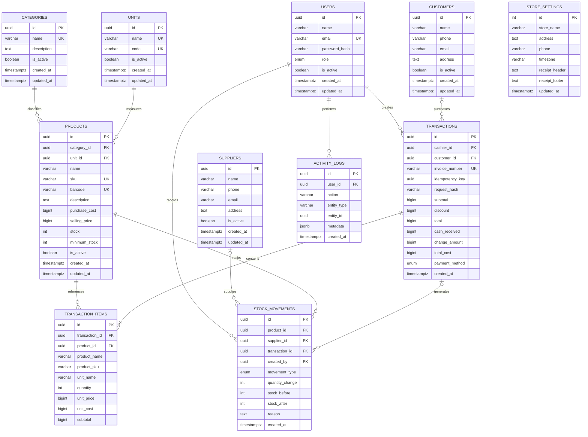

# Diagram Relasi Entitas (Entity Relationship Diagram - ERD)

## 1. Informasi Dokumen

| Atribut | Nilai |
|---|---|
| Proyek | CashierFlow |
| Versi Dokumen | 1.0 |
| Mesin Basis Data | PostgreSQL |
| ORM | Prisma |
| Penulis | ZyxxBoy |
| Fase Pengembangan | Hari ke-02 - Perancangan Basis Data |
| Status | Design Baseline |

## 2. Gambaran Umum

Basis data CashierFlow dirancang menggunakan model data relasional untuk mendukung modul manajemen produk, pengawasan inventaris stok, transaksi penjualan kasir, administrasi pengguna, dan pelaporan performa bisnis.

Desain ini memprioritaskan integritas data, akurasi historis, atomisitas transaksi, dan kemudahan pemeliharaan jangka panjang.

## 3. Klasifikasi Entitas

| Entitas | Modul Terkait | Prioritas MVP |
|---|---|---|
| users | Autentikasi & Administrasi Pengguna | Must |
| categories | Data Master | Must |
| units | Data Master | Must |
| suppliers | Data Master | Must |
| products | Data Master & Inventaris | Must |
| customers | Data Master | Should |
| stock_movements | Manajemen Inventaris | Must |
| transactions | Manajemen Transaksi & POS | Must |
| transaction_items | Manajemen Transaksi | Must |
| activity_logs | Administrasi | Should |
| store_settings | Pengaturan Toko | Should |

## 4. Diagram Relasi Entitas

## 5. Definisi Relasi Entitas

| Tabel Induk (Parent) | Tabel Anak (Child) | Kardinalitas | Foreign Key |
|---|---|---|---|
| categories | products | 1:N | category_id |
| units | products | 1:N | unit_id |
| users | transactions | 1:N | cashier_id |
| users | stock_movements | 1:N | created_by |
| users | activity_logs | 1:N | user_id |
| customers | transactions | 0..1:N | customer_id |
| suppliers | stock_movements | 0..1:N | supplier_id |
| products | stock_movements | 1:N | product_id |
| products | transaction_items | 1:N | product_id |
| transactions | transaction_items | 1:N | transaction_id |
| transactions | stock_movements | 0..1:N | transaction_id |

## 6. Definisi Tipe Enumerasi

### UserRole

- OWNER (Pemilik Usaha)
- ADMIN (Administrator)
- CASHIER (Kasir)

### MovementType

- STOCK_IN (Barang Masuk)
- STOCK_OUT (Barang Keluar Manual)
- ADJUSTMENT (Penyesuaian Fisik / Opname)
- SALE (Pemotongan Penjualan Kasir)

### PaymentMethod

- CASH (Tunai)

## 7. Aturan Perancangan Basis Data

- Setiap entitas bisnis inti menggunakan tipe data UUID sebagai Primary Key.
- Pengaturan toko (`store_settings`) menggunakan Primary Key integer singleton bernilai 1.
- Foreign Key digunakan untuk menjamin integritas referensial.
- Nilai finansial/moneter disimpan dalam tipe BIGINT dengan satuan Rupiah (IDR) bulat tanpa desimal.
- Kuantitas stok inventaris menggunakan tipe INTEGER.
- Seluruh kolom waktu menggunakan tipe TIMESTAMPTZ (sadar zona waktu).
- Relasi opsional menggunakan nilai NULL jika tidak ada referensi.
- Transaksi penjualan yang telah selesai dan mutasi stok bersifat abadi (immutable).
- Nilai transaksi historis disimpan menggunakan snapshot harga dan nama pada saat transaksi terjadi.
- Nilai stok produk dilarang keras menjadi negatif (`stock >= 0`).
- Rekaman data yang sudah direferensikan dilarang dihapus permanen.
- Setiap transaksi yang berhasil wajib memiliki minimal satu baris item transaksi.

## 8. Keunikan Komposit (Composite Uniqueness)

Tabel `transactions` wajib menegakkan konstrain keunikan komposit untuk:

    (cashier_id, idempotency_key)

Tabel `transaction_items` wajib menegakkan konstrain keunikan komposit untuk:

    (transaction_id, product_id)

Setiap penjualan yang berhasil wajib memiliki tepat satu rekaman mutasi stok (tipe SALE) untuk masing-masing produk yang dibeli.

## 9. Strategi Modul Opsional

Entitas `customers`, `activity_logs`, dan `store_settings` merupakan prioritas sekunder (Should Have) dalam rilis MVP.

Jika modul pelanggan ditunda, tabel pelanggan beserta relasinya dapat ditambahkan melalui migrasi lanjutan di masa depan.

Informasi default profil toko dapat disediakan melalui variabel konfigurasi aplikasi jika antarmuka modul pengaturan belum tersedia.

## 10. Dokumen Terkait

- [Spesifikasi Perancangan Basis Data](database-design.md)
- [Kamus Data Basis Data](data-dictionary.md)
- [Matriks CRUD](crud-matrix.md)
- [Matriks RBAC](rbac-matrix.md)
- [Spesifikasi Aturan Bisnis](business-rules.md)
- [Arsitektur Sistem](architecture.md)
