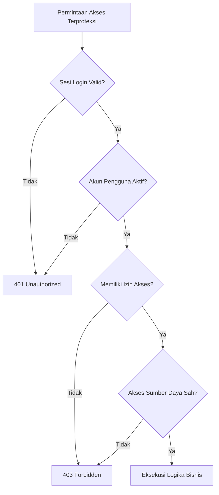

# Matriks Kontrol Akses Berbasis Peran (RBAC Matrix)

## 1. Informasi Dokumen

| Atribut | Nilai |
|---|---|
| Proyek | CashierFlow |
| Versi Dokumen | 1.0 |
| Penulis | ZyxxBoy |
| Model Otorisasi | Role-Based Access Control (RBAC) |
| Status | Design Baseline |

## 2. Gambaran Umum

CashierFlow menerapkan Kontrol Akses Berbasis Peran (Role-Based Access Control - RBAC) untuk membatasi fitur aplikasi dan data bisnis sesuai dengan wewenang serta tanggung jawab pengguna yang terautentikasi.

Sistem MVP menggunakan peran bawaan yang telah ditentukan (*predefined roles*) dan tidak memerlukan skema izin kustom dinamis yang rumit pada basis data awal.

## 3. Peran Aplikasi

| Peran | Deskripsi |
|---|---|
| OWNER | Pemilik usaha dengan akses menyeluruh terhadap finansial, laba kotor, dan administrasi sistem |
| ADMIN | Administrator operasional yang bertanggung jawab atas master data produk dan pengelolaan stok |
| CASHIER | Staf kasir yang bertanggung jawab melayani transaksi penjualan dan pembayaran tunai di kasir |

Setiap akun pengguna memiliki tepat satu peran aktif.

## 4. Legenda Izin

- **Y**: Diizinkan penuh (*Permission granted*).
- **N**: Ditolak (*Permission denied*).
- **Own**: Dibatasi hanya untuk rekaman yang dibuat oleh pengguna yang bersangkutan (*Owner-only access*).

## 5. Izin Autentikasi

| Izin Akses | Owner | Admin | Kasir |
|---|---|---|---|
| auth.login | Y | Y | Y |
| auth.logout | Y | Y | Y |
| auth.change_password | Y | Y | Y |
| profile.read | Y | Y | Y |

Fitur ubah kata sandi mandiri adalah fitur prioritas sekunder MVP.

Hanya akun pengguna dengan status aktif yang diizinkan mengakses operasi terproteksi.

## 6. Izin Dasbor (Dashboard)

| Izin Akses | Owner | Admin | Kasir |
|---|---|---|---|
| dashboard.read | Y | Y | N |
| dashboard.sales | Y | Y | N |
| dashboard.inventory | Y | Y | N |
| dashboard.profit | Y | N | N |

## 7. Izin Manajemen Produk

| Izin Akses | Owner | Admin | Kasir |
|---|---|---|---|
| products.read | Y | Y | N |
| products.create | Y | Y | N |
| products.update | Y | Y | N |
| products.deactivate | Y | Y | N |
| products.reactivate | Y | Y | N |
| products.read_cost | Y | Y | N |

Kasir hanya dapat membaca data produk yang siap dijual melalui antarmuka kasir (POS).

Harga beli/modal produk dapat dilihat oleh Owner dan Admin untuk keperluan operasional pengadaan, namun laporan agregat laba kotor dibatasi secara ketat hanya untuk Owner.

## 8. Izin Kategori Produk

| Izin Akses | Owner | Admin | Kasir |
|---|---|---|---|
| categories.read | Y | Y | N |
| categories.create | Y | Y | N |
| categories.update | Y | Y | N |
| categories.delete | Y | Y | N |
| categories.deactivate | Y | Y | N |

## 9. Izin Satuan Produk (Units)

| Izin Akses | Owner | Admin | Kasir |
|---|---|---|---|
| units.read | Y | Y | N |
| units.create | Y | Y | N |
| units.update | Y | Y | N |
| units.delete | Y | Y | N |
| units.deactivate | Y | Y | N |

## 10. Izin Pemasok (Suppliers)

| Izin Akses | Owner | Admin | Kasir |
|---|---|---|---|
| suppliers.read | Y | Y | N |
| suppliers.create | Y | Y | N |
| suppliers.update | Y | Y | N |
| suppliers.delete | Y | Y | N |
| suppliers.deactivate | Y | Y | N |

## 11. Izin Pelanggan (Customers)

| Izin Akses | Owner | Admin | Kasir |
|---|---|---|---|
| customers.read | Y | Y | N |
| customers.create | Y | Y | N |
| customers.update | Y | Y | N |
| customers.deactivate | Y | Y | N |
| pos.customers.search | Y | N | Y |

Pencarian pelanggan di layar POS hanya mengembalikan data identitas minimal tanpa membeberkan seluruh basis data pelanggan.

Izin ini hanya berlaku jika modul pelanggan telah diimplementasikan.

## 12. Izin Inventaris

| Izin Akses | Owner | Admin | Kasir |
|---|---|---|---|
| inventory.read | Y | Y | N |
| inventory.stock_in | Y | Y | N |
| inventory.stock_out | Y | Y | N |
| inventory.adjustment | Y | Y | N |
| inventory.movements.read | Y | Y | N |

Kasir tidak memiliki izin untuk melakukan penyesuaian stok manual.

Pemotongan stok yang disebabkan oleh penjualan hanya dapat dipicu melalui layanan checkout yang terotorisasi.

## 13. Izin Point of Sale (POS)

| Izin Akses | Owner | Admin | Kasir |
|---|---|---|---|
| pos.access | Y | N | Y |
| pos.products.search | Y | N | Y |
| pos.cart.manage | Y | N | Y |
| pos.discount.apply | Y | N | Y |
| pos.checkout | Y | N | Y |

Izin diskon hanya aktif jika fitur diskon telah diimplementasikan.

Batasan maksimal nominal diskon tetap wajib mengikuti aturan bisnis yang berlaku.

## 14. Izin Transaksi

| Izin Akses | Owner | Admin | Kasir |
|---|---|---|---|
| transactions.read_all | Y | Y | N |
| transactions.read_own | Y | Y | Own |
| transactions.read_cost | Y | N | N |
| receipts.read_all | Y | Y | N |
| receipts.read_own | Y | Y | Own |
| receipts.print_all | Y | Y | N |
| receipts.print_own | Y | Y | Own |
| transactions.update | N | N | N |
| transactions.delete | N | N | N |

Kasir hanya diizinkan untuk mengakses detail transaksi jika:

    transaction.cashier_id = authenticated_user.id

Data transaksi yang telah berstatus selesai tidak dapat diedit atau dihapus oleh peran mana pun.

## 15. Izin Pelaporan

| Izin Akses | Owner | Admin | Kasir |
|---|---|---|---|
| reports.sales.read | Y | Y | N |
| reports.profit.read | Y | N | N |
| reports.stock.read | Y | Y | N |
| reports.sales.export | Y | Y | N |
| reports.profit.export | Y | N | N |
| reports.stock.export | Y | Y | N |

Izin ekspor hanya berlaku apabila fungsionalitas ekspor telah diimplementasikan.

## 16. Izin Administrasi Pengguna

| Izin Akses | Owner | Admin | Kasir |
|---|---|---|---|
| users.read | Y | N | N |
| users.create | Y | N | N |
| users.update | Y | N | N |
| users.assign_role | Y | N | N |
| users.activate | Y | N | N |
| users.deactivate | Y | N | N |
| users.delete | N | N | N |
| roles.read | Y | N | N |

Peran bersifat bawaan sistem dan tidak dapat dibuat atau dihapus melalui aplikasi.

Administrasi akun Owner wajib mempertahankan minimal satu akun Owner yang berstatus aktif.

## 17. Izin Audit dan Pengaturan

| Izin Akses | Owner | Admin | Kasir |
|---|---|---|---|
| activity_logs.read | Y | N | N |
| activity_logs.update | N | N | N |
| activity_logs.delete | N | N | N |
| settings.read | Y | N | N |
| settings.update | Y | N | N |

Rekaman audit digenerate secara otomatis oleh layanan aplikasi di sisi server.

Pencetakan struk dan laporan dapat membaca informasi non-sensitif toko secara internal tanpa harus membuka akses umum ke halaman pengaturan.

## 18. Pembatasan Tingkat Data (Data-Level Restrictions)

| Bidang Data | Owner | Admin | Kasir |
|---|---|---|---|
| Harga modal produk terkini | Ya | Ya | Tidak |
| Harga jual produk | Ya | Ya | Ya |
| Kuantitas stok produk tersedia | Ya | Ya | Ya |
| Snapshot modal item historis | Ya | Tidak | Tidak |
| Total modal transaksi | Ya | Tidak | Tidak |
| Total laba kotor agregat | Ya | Tidak | Tidak |
| Hash kata sandi | Tidak | Tidak | Tidak |
| Kunci rahasia autentikasi | Tidak | Tidak | Tidak |
| Riwayat transaksi kasir lain | Ya | Ya | Tidak |

Akses kasir terhadap data produk dibatasi hanya untuk data yang dibutuhkan pada modul POS.

## 19. Matriks Akses Halaman (Page Access Matrix)

| Rute URL | Owner | Admin | Kasir |
|---|---|---|---|
| /dashboard | Ya | Ya | Tidak |
| /pos | Ya | Tidak | Ya |
| /master-data/products | Ya | Ya | Tidak |
| /master-data/categories | Ya | Ya | Tidak |
| /master-data/units | Ya | Ya | Tidak |
| /master-data/suppliers | Ya | Ya | Tidak |
| /master-data/customers | Ya | Ya | Tidak |
| /inventory | Ya | Ya | Tidak |
| /transactions | Ya | Ya | Khusus Milik Sendiri |
| /reports/sales | Ya | Ya | Tidak |
| /reports/profit | Ya | Tidak | Tidak |
| /reports/stock | Ya | Ya | Tidak |
| /administration/users | Ya | Tidak | Tidak |
| /administration/roles | Ya | Tidak | Tidak |
| /administration/activity-logs | Ya | Tidak | Tidak |
| /settings | Ya | Tidak | Tidak |

Tujuan pengalihan default setelah login berhasil:

- Owner: `/dashboard`
- Admin: `/dashboard`
- Kasir: `/pos`

## 20. Alur Penegakan Otorisasi

Alur ini bersifat logis. Permintaan halaman dan Server Actions dapat menggunakan pengalihan (redirect) atau pesan error terstruktur sebagai pengganti respons status HTTP langsung.

## 21. Persyaratan Keamanan

- Otorisasi wajib diterapkan secara mutlak di sisi server.
- Gunakan kebijakan penolakan bawaan (*deny-by-default*).
- Validasi ulang status keaktifan dan peran efektif pengguna pada setiap operasi.
- Terapkan pemeriksaan kepemilikan data (*resource ownership check*).
- Dilarang memercayai identifier peran yang dikirimkan oleh klien.
- Kolom data yang dibatasi dilarang bocor ke antarmuka klien.
- Sembunyikan menu navigasi yang tidak diizinkan demi kenyamanan pengguna (UX).
- Visibilitas elemen UI bukan merupakan batasan keamanan sistem.
- Pastikan keamanan tetap terjaga pada akses URL langsung maupun Route Handlers.
- Uji skenario akses lintas pengguna dan percobaan eskalasi hak istimewa (*privilege escalation*).

## 22. Skenario Pengujian Otorisasi

| Kode Uji | Skenario | Hasil yang Diharapkan |
|---|---|---|
| RBAC-001 | Owner membuka manajemen pengguna | Diizinkan |
| RBAC-002 | Admin membuka manajemen produk | Diizinkan |
| RBAC-003 | Kasir mencoba membuat produk via API | Ditolak (403 Forbidden) |
| RBAC-004 | Kasir mencoba membuka transaksi milik kasir lain | Ditolak (403 Forbidden) |
| RBAC-005 | Admin mencoba membuka laporan laba kotor | Ditolak (403 Forbidden) |
| RBAC-006 | Admin mencoba melakukan checkout kasir | Ditolak (403 Forbidden) |
| RBAC-007 | Kasir memproses checkout yang valid | Diizinkan |
| RBAC-008 | Akun nonaktif mencoba melakukan operasi terproteksi | Ditolak (401/403) |
| RBAC-009 | Owner mencoba menonaktifkan akun Owner aktif terakhir | Ditolak oleh sistem |
| RBAC-010 | Owner mencoba menghapus transaksi yang telah selesai | Ditolak oleh sistem |
| RBAC-011 | Pengguna tanpa login mencoba mengakses dasbor | Ditolak (401/Redirect Login) |
| RBAC-012 | Kasir meminta informasi harga modal produk | Data disembunyikan/tidak dikirim |
| RBAC-013 | Admin mengekspor laporan penjualan | Diizinkan tanpa kolom modal/laba |
| RBAC-014 | Pengguna mengirimkan payload manipulasi peran palsu | Diabaikan atau ditolak |

## 23. Dokumen Terkait

- [Dokumen Persyaratan Produk (PRD)](PRD.md)
- [Persyaratan Fungsional (FRS)](functional-requirements.md)
- [Matriks CRUD](crud-matrix.md)
- [Spesifikasi Aturan Bisnis](business-rules.md)
- [Arsitektur Sistem](architecture.md)
